# panel-termux

[English](README.md) · **Bahasa Indonesia**

Jadikan HP Android bekas server untuk aplikasi Bun: panel web untuk mengelola layanan runit, aplikasi pm2, domain Cloudflare Tunnel, database Postgres, situs, deploy binary, dan cadangan. Akses lewat login Google, tanpa root dan tanpa Docker.

> Antarmuka berbahasa Inggris secara bawaan; bahasa Indonesia tersedia di **Profil → Bahasa** (untuk CLI, `panel init` menanyakannya, atau isi `PANEL_LANG=id`). Lihat [Bahasa](#bahasa). Label di README ini memakai teks antarmuka bahasa Indonesia.

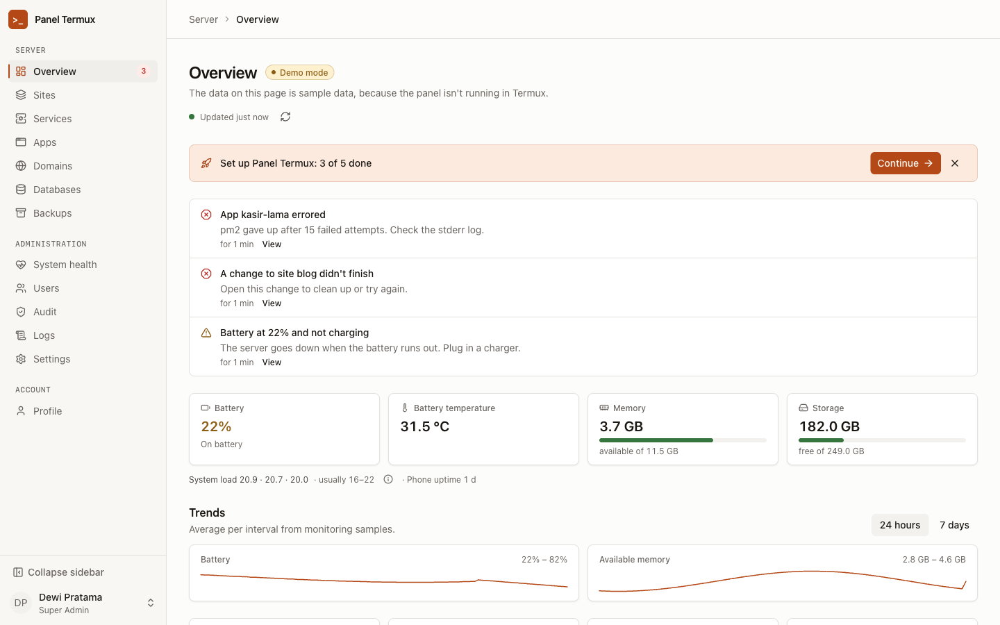

- [Fitur unggulan](#fitur-unggulan)
- [Masalah yang diselesaikan](#masalah-yang-diselesaikan)
- [Instal di HP](#instal-di-hp)
- [Kebutuhan dan konfigurasi](#kebutuhan-dan-konfigurasi)
- [Bahasa](#bahasa)
- [Perintah CLI](#perintah-cli)
- [Troubleshooting](#troubleshooting)
- [Cadangan dan pemulihan](#cadangan-dan-pemulihan) · [Rollback](#rollback) · [Keamanan](#keamanan) · [Development](#development-lokal)

## Fitur unggulan

**Dibuat untuk layar HP.** Semua halaman nyaman dipakai dari HP, dengan bar navigasi bawah dan mode gelap. Ringkasan menampilkan masalah lebih dulu, atau "Semua sehat".

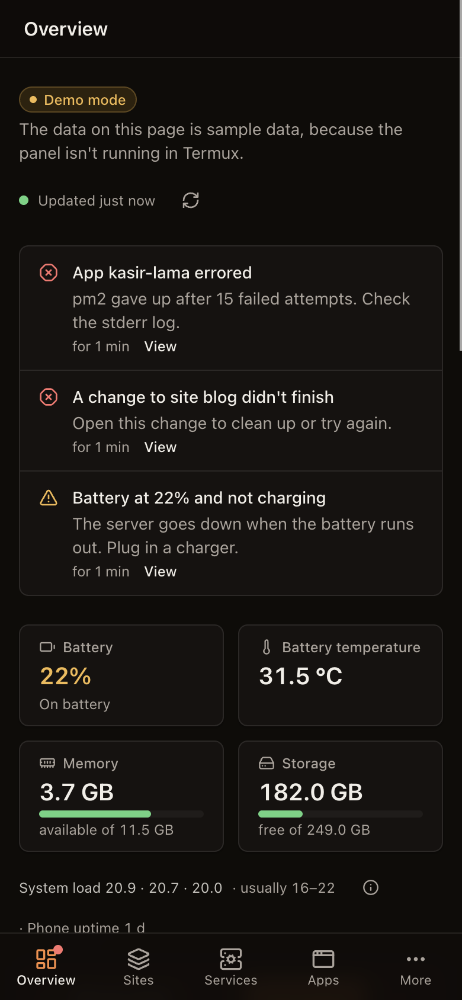

**Panel memperbaiki sendiri.** **Situs → Persiapan** memeriksa integrasi pm2 dan menampilkan satu baris per masalah. Tombol **Perbaiki** atau **Perbaiki semua** menjelaskan dulu perubahannya dalam bahasa awam, dengan diff di **Lihat perubahan pada file**. Salinan file lama disimpan, dan **Batalkan perubahan** mengembalikannya. Tidak perlu membuka `nano` di Termux. Rinciannya di [Integrasi pm2](#integrasi-pm2-appsjson).

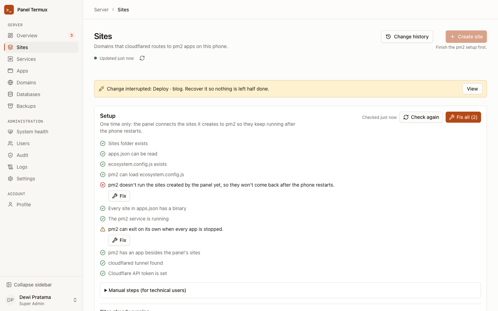
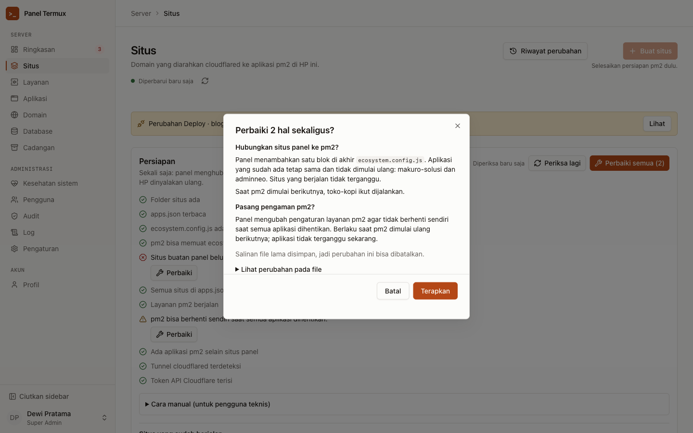

**Deploy binary yang aman.** Unggah binary Bun dari browser. Unggahan terputus bisa dilanjutkan (**Lanjutkan unggahan**). Panel menunggu sampai aplikasi sehat, dan bila tidak sehat dalam batas waktu, deploy dikembalikan otomatis. **Kembalikan versi sebelumnya** tersedia kapan saja. Lihat [Deploy binary](#deploy-binary).

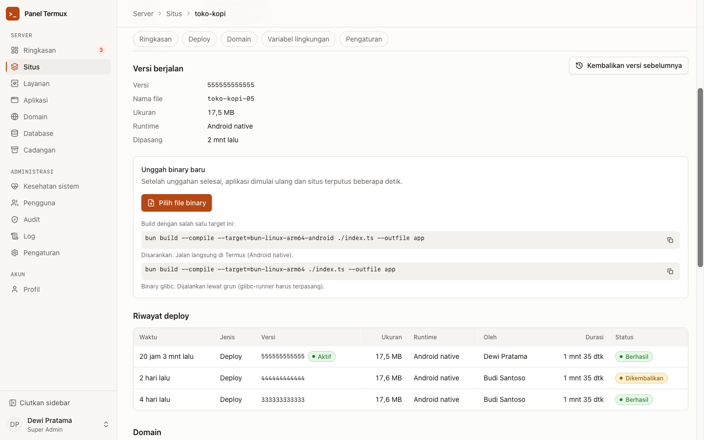

**Wizard situs baru dengan DNS otomatis.** Isi nama, hostname, port, dan database opsional. Panel membuat folder, database, `.env`, entri pm2, ingress tunnel, dan CNAME DNS sekaligus, dan meng-undo langkah sebelumnya bila satu langkah gagal. Lihat [Membuat situs](#membuat-situs).

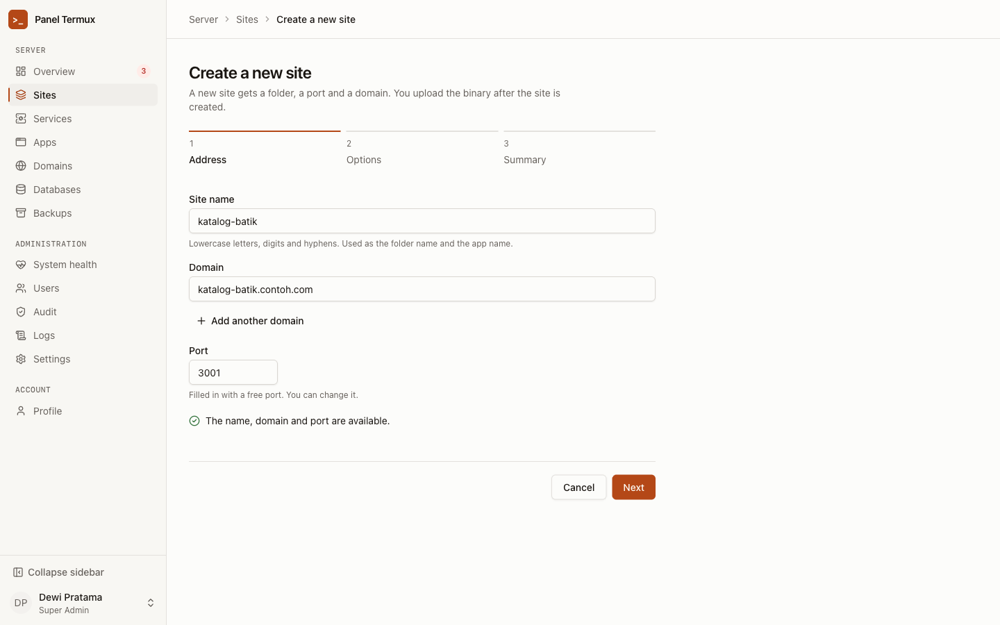

**Cadangan harian ke S3/R2 dengan uji pemulihan.** Database Postgres, folder situs, konfigurasi tunnel, dan `panel.db` diunggah tiap hari dengan checksum dan retensi. **Pulihkan ke database baru** membuktikan cadangan bisa dipulihkan tanpa menyentuh database asli. Lihat [Cadangan dan pemulihan](#cadangan-dan-pemulihan).

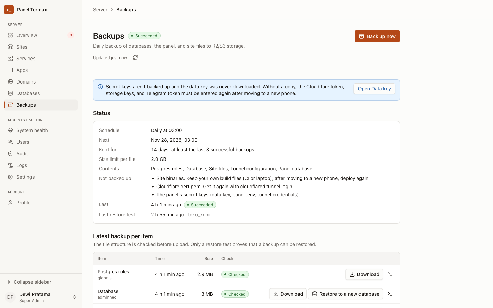

**Pemantauan dan notifikasi Telegram.** Sampler membaca baterai, memori, penyimpanan, layanan, aplikasi, dan domain tiap 60 detik (bisa diatur). Masalah baru, yang makin gawat, dan yang sudah pulih dikirim ke Telegram. Lihat [Pemantauan dan notifikasi](#pemantauan-dan-notifikasi).

**Kesehatan sistem dan penyiapan.** Super admin melihat kartu penyiapan (Cloudflare Access, kunci data, cadangan, token Cloudflare, situs pertama, admin) beserta kemajuannya, dan keadaan panel di satu halaman.

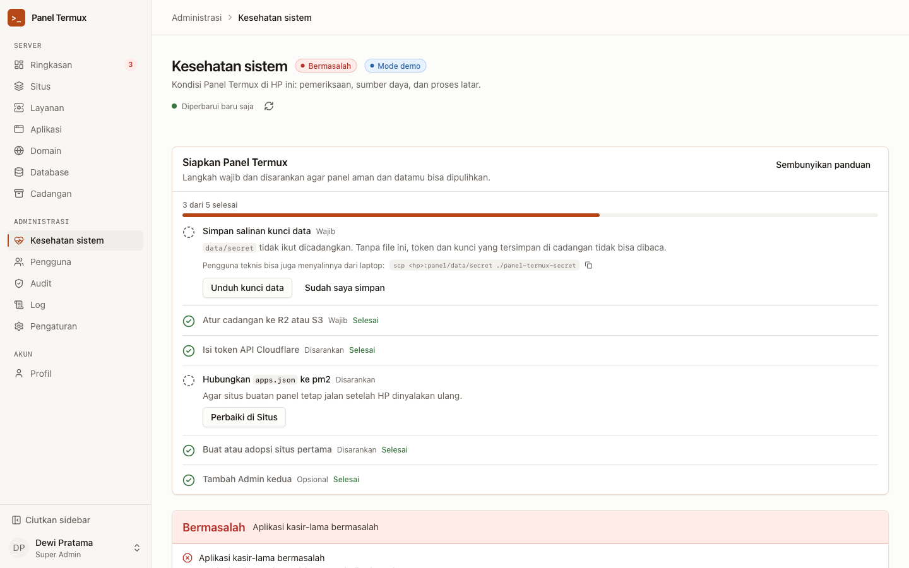

**Audit yang bisa dibaca.** Setiap perubahan tercatat: siapa, kapan, dari perangkat apa, dalam kalimat biasa. Bisa difilter dan diekspor CSV.

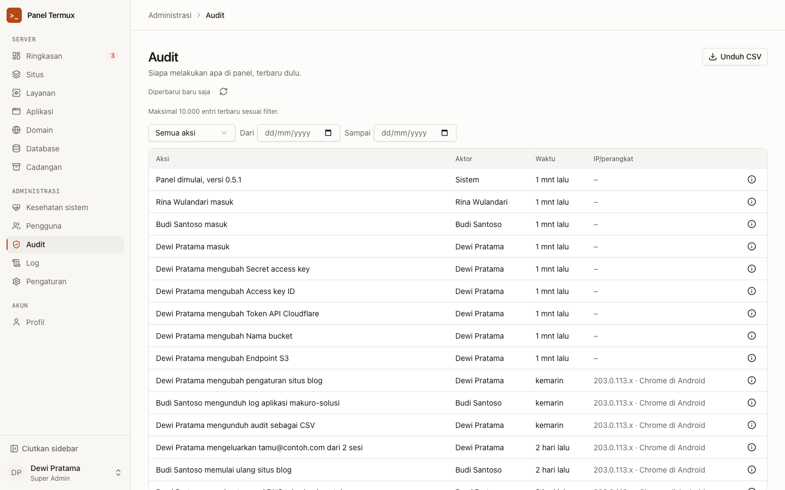

**Pengaturan dari browser.** Token Cloudflare, kunci S3/R2, dan bot Telegram diisi di Pengaturan, dengan tombol uji koneksi. Nilai rahasia disimpan terenkripsi dan tidak pernah ditampilkan lagi.

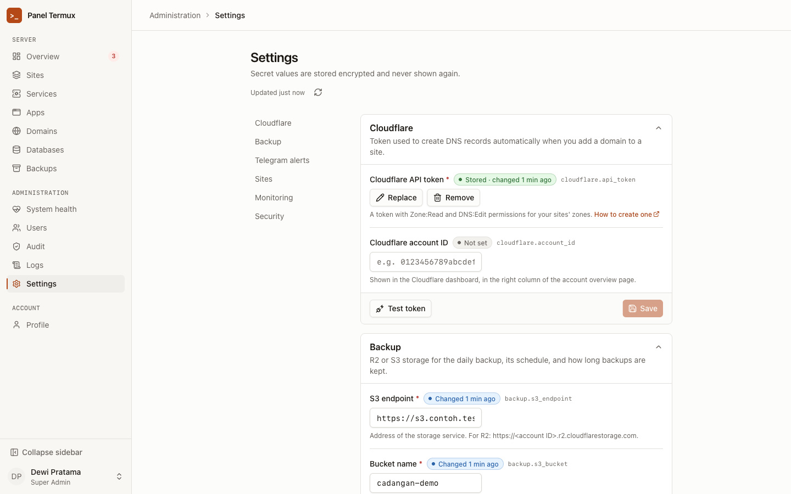

**Aman secara bawaan.** Panel hanya listen di `127.0.0.1` dan diakses lewat Cloudflare Tunnel. Path privat dilindungi Cloudflare Access, permintaan yang mengubah data dijaga dari CSRF, dan peran (`user`, `admin`, `super_admin`) dicek di server. Lihat [Keamanan](#keamanan).

**Halaman produk publik.** `/` menjelaskan panel kepada tamu, lengkap dengan baris pasang, dan tombol "Masuk dengan Google".

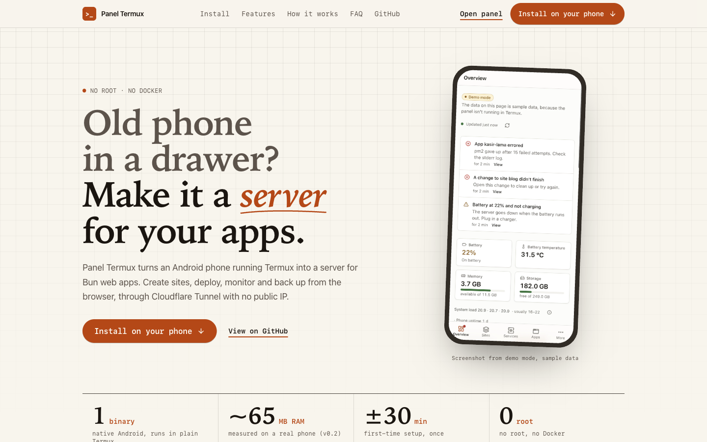

**Satu baris pasang, satu perintah periksa.** `panel init` menyiapkan Termux kosong sampai panel menyala. `panel doctor` memeriksa HP tanpa mengubah apa pun dan menyebut langkah berikutnya untuk tiap masalah.

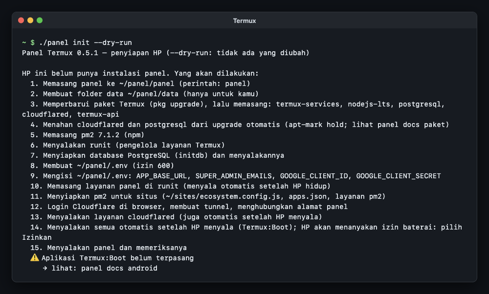
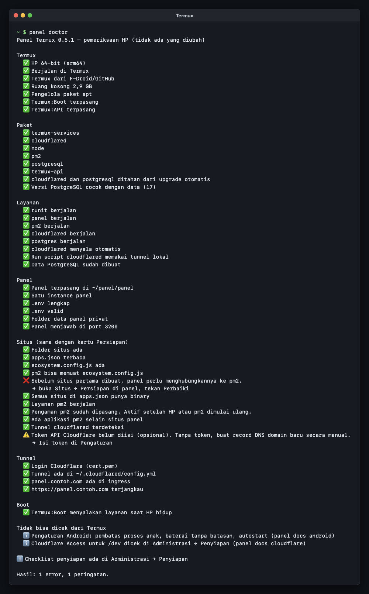

## Masalah yang diselesaikan

- **HP bekas jadi server tanpa root dan tanpa Docker.** Aplikasi Bun di-compile jadi satu binary dan dijalankan pm2 di Termux; domain publik lewat Cloudflare Tunnel, tanpa IP publik atau port forwarding.
- **Tidak perlu menghafal perintah Termux.** Pemasangan satu baris; sesudahnya layanan, situs, domain, dan database dikelola dari browser. Masalah setup diperbaiki dengan tombol **Perbaiki**, bukan dengan mengedit file.
- **Deploy tidak membuat situs mati.** Binary lama disimpan, kesehatan aplikasi dicek, dan versi yang gagal dikembalikan otomatis.
- **Data tidak hilang bila HP rusak atau dicuri.** Cadangan harian ke S3/R2 dengan runbook [Pulihkan ke HP baru](#pulihkan-ke-hp-baru).
- **Tahu saat ada yang rusak.** Ringkasan, riwayat masalah, dan notifikasi Telegram untuk baterai, layanan mati, aplikasi crash, domain tidak menjawab, dan cadangan basi.
- **Upgrade tanpa merusak HP.** `pkg upgrade` tidak pernah dijalankan saat data PostgreSQL ada, `cloudflared` dan `postgresql` ditahan, dan panel bisa di-[rollback](#rollback).

## Instal di HP

Ringkasnya: siapkan aplikasi Android, buat Google OAuth client, jalankan satu baris di Termux, lalu lindungi path privat dengan Cloudflare Access.

1. **Aplikasi Android.** Pasang Termux, Termux:Boot, dan Termux:API dari sumber yang sama (F-Droid atau GitHub, bukan Play Store). Buka Termux:Boot sekali. Rincian dan pengaturan baterai: `panel docs android` atau [docs/cli/android.md](docs/cli/android.md).

2. **Google OAuth client.** Buat client tipe Web application dengan redirect URI `https://<alamat panel>/api/auth/callback/google`. Langkahnya di [Google OAuth client](#google-oauth-client).

3. **Jalankan satu baris ini di Termux.** Baris yang sama dipakai untuk memasang di HP baru, memperbarui, dan memperbaiki:

   ```sh
   cd && curl -fL --retry 3 -o panel-termux https://github.com/makurosolusi/panel-termux/releases/latest/download/panel && chmod +x panel-termux && ./panel-termux init
   ```

   Baris ini baru jalan setelah v0.5.1 dirilis (aset `panel` belum ada di rilis sebelumnya). Untuk versi tertentu, ganti `latest/download` dengan `download/<tag>`. Mau melihat rencananya dulu tanpa mengubah apa pun: `./panel-termux init --dry-run`.

   `panel init` memasang binary ke `~/panel/panel`, lalu menyiapkan paket, runit, PostgreSQL, `~/panel/.env`, layanan panel, pm2, tunnel cloudflared, Termux:Boot, dan menyalakan panel. Sebelum mengubah apa pun, init mencetak rencananya dan meminta persetujuan. Aman dijalankan ulang: yang sudah ada tidak ditimpa. Yang ditanyakan (hanya yang masih kosong):
   - **Language / Bahasa** untuk CLI (ditanya sekali, disimpan sebagai `PANEL_LANG`);
   - **alamat panel**, mis. `panel.contoh.com` (menjadi `APP_BASE_URL`);
   - **email Google admin** (`SUPER_ADMIN_EMAILS`);
   - **Google Client ID dan secret**. Init mencetak redirect URI yang harus ditempel di "Authorized redirect URIs" OAuth client, yaitu `https://<alamat>/api/auth/callback/google`;
   - **login Cloudflare**: init mencetak tautan login cloudflared; buka, klik, dan pilih domain. Init lalu membuat atau memakai ulang tunnel, menambah hostname panel ke `~/.cloudflared/config.yml`, dan membuat DNS-nya.

   Jawaban `.env` langsung disimpan (mode 600) dan nilainya tidak pernah dicetak. Bila terputus di tengah, jalankan baris yang sama lagi: init melanjutkan dari yang belum ada. Ikuti catatan yang dicetak di akhir (izin baterai, buka Termux:Boot sekali).

   **Memperbarui** = jalankan baris yang sama lagi. Hanya binary yang ditukar (versi lama disimpan sebagai `panel.prev`) dan layanan panel di-restart. Setelah itu buka **Situs → Persiapan**: bila ada yang perlu disesuaikan, tekan **Perbaiki semua** di sana.

   Opsi `panel init`:

   | Opsi                              | Fungsi                                                                                                                                                                                          |
   | --------------------------------- | ----------------------------------------------------------------------------------------------------------------------------------------------------------------------------------------------- |
   | `-y`, `--yes`                     | Jawab ya untuk rencana, termasuk restart panel saat upgrade (untuk skrip tanpa terminal).                                                                                                       |
   | `--dry-run`                       | Hanya mencetak rencana; tidak ada yang diubah.                                                                                                                                                  |
   | `--hostname <domain>`             | Alamat panel, tidak ditanya lagi.                                                                                                                                                               |
   | `--admin-email <email>`           | Email Google super admin; boleh diulang.                                                                                                                                                        |
   | `--skip <postgres\|tunnel\|boot>` | Lewati satu bagian; boleh diulang.                                                                                                                                                              |
   | `--ssh-key <https-url\|file\|->`  | Tambah kunci SSH dari URL `https://`, file, atau `-` (tempel), lalu nyalakan sshd hanya dengan kunci dan buat menyala saat HP hidup. Jalankan lagi bila init bilang SSH tidak menyala otomatis. |
   | `--skip-verify`                   | Lewati cek diri terhadap `SHA256SUMS` rilis. Hanya di terminal, dengan konfirmasi.                                                                                                              |
   | `--lang <en\|id>`                 | Bahasa CLI untuk sekali jalan (semua perintah menerimanya); tanpa ini, init bertanya sekali.                                                                                                    |

   <details>
   <summary>Mode init, yang dijaga init, dan cek diri</summary>

   Mode dipilih sendiri dari keadaan HP:
   - **HP baru** (belum ada PostgreSQL, `~/.cloudflared`, `~/.pm2`, `~/sites`, atau `panel.db`): semua langkah.
   - **Upgrade** (binary ini lebih baru dari yang terpasang): hanya binary ditukar dan layanan panel di-restart.
   - **Perbaiki** (versi sama): hanya melengkapi yang belum ada. Paket, PostgreSQL, dan Termux:Boot butuh terminal.

   Binary yang lebih lama dari yang terpasang ditolak; untuk kembali pakai [`panel rollback`](#rollback).

   Yang dijaga init:
   - `pkg upgrade` hanya di HP baru tanpa PostgreSQL. Bila data PostgreSQL ada, tidak pernah ada `pkg upgrade`, dan pemasangan paket yang akan mengganti `cloudflared`, `postgresql`, atau `nodejs` ditolak. `cloudflared` dan `postgresql` ditahan (hold) dari `pkg upgrade`, lihat `panel docs packages`.
   - `ecosystem.config.js` tulisan tangan dan setup pm2 yang sudah ada tidak disentuh. Yang perlu disesuaikan dikerjakan lewat **Situs → Persiapan → Perbaiki**.
   - Record DNS yang mengarah ke tunnel lain hanya dipindah setelah kamu menjawab ya di terminal.
   - pm2 tidak pernah di-restart. Panel hanya di-restart saat upgrade; di mode lain panel yang sedang jalan dibiarkan.

   Bila ada perubahan situs yang sedang berjalan (deploy, buat situs, dll.), restart panel saat upgrade menunggu perubahan itu selesai, **sampai 2 menit**. Selama itu panel tidak terjangkau. Perubahan yang belum selesai setelah 2 menit terputus dan tampil sebagai "Terputus" di Riwayat perubahan, dengan tombol **Pulihkan** untuk membereskannya.

   **Cek diri**: sebelum memasang, init mencocokkan dirinya dengan baris `panel` di `SHA256SUMS` rilisnya (diunduh lewat HTTPS). Ini membuktikan unduhan utuh, bukan asal rilis. Untuk memastikan asal rilis (opsional, di komputer): `gh attestation verify panel --repo makurosolusi/panel-termux`.

   `install.sh` dari rilis lama masih ada sebagai shim selama 0.6.x: ia mengunduh `panel`, mencocokkannya dengan `SHA256SUMS`, lalu menjalankan `panel init` (dihapus di 0.7.0). `scripts/install-phone.sh` sudah dihapus.

   </details>

4. **Lindungi path privat panel dengan Cloudflare Access.** Landing page `/`, alur login Google, dan `/profile` sengaja tetap publik.

   Di Cloudflare dashboard: **Zero Trust → Access controls → Applications → Create new application → Self-hosted and private**. Buat **satu** aplikasi, lalu **Add public hostname** sekali per path (domain `panel.<domain>` sama semua):

   | Path (kolom **Path**) | Melindungi                                    |
   | --------------------- | --------------------------------------------- |
   | `panel`               | halaman `/panel` dan `/panel/...`             |
   | `dev`                 | halaman `/dev` dan `/dev/...`                 |
   | `api/panel`           | API `/api/panel/...` (termasuk upload deploy) |
   | `api/dev`             | API `/api/dev/...`                            |

   Tulis path **tanpa** `/*`: menurut dokumentasi Access, `panel/*` hanya mencakup `/panel/<sesuatu>` dan **tidak** mencakup `/panel` itu sendiri, sedangkan `panel` mencakup path itu beserta sub-path-nya. Kosongkan kolom Path berarti seluruh hostname terlindungi, termasuk landing page, jadi jangan lakukan itu. Query string tidak didukung di path Access (tidak masalah, panel tidak memakainya untuk routing).

   Tambahkan satu policy **Allow** dengan selector **Emails** berisi email pemilik panel (boleh lebih dari satu), lalu **Create**. Saat menjadikan seseorang Admin, tambahkan juga emailnya ke policy Access.

   Access hanya lapisan di depan. Di belakangnya login Google panel dan peran tetap berlaku, dan `/api/panel/*` serta `/api/dev/*` tetap dijaga peran di server walaupun Access salah konfigurasi. Kesehatan sistem menampilkan "Cloudflare Access belum terdeteksi" sampai panel melihat permintaan `/api/panel` atau `/api/dev` yang membawa token Access.

   <details>
   <summary>Yang sengaja tidak dilindungi Access, dan perilaku login Access di SPA</summary>

   Yang sengaja **tidak** dilindungi Access, dan alasannya:
   - `/` (landing page) dan `/login`: harus bisa dibuka siapa pun.
   - `/profile`: hanya menampilkan akunmu sendiri dari `/api/me`, dan akun Google lain yang login perlu melihat penjelasan "belum punya akses" di sana.
   - `/api/auth/...`: sign-in Google dan callback Better Auth; bila dilindungi, login dari landing page tidak jalan untuk tamu.
   - `/api/me`: dipanggil landing page untuk tamu (jawab 401 bila belum login); bila dilindungi, fetch-nya dialihkan ke halaman login Access dan landing page gagal memuat.
   - `/api/health` dan aset bundle di root (`/chunk-*.js`, `/chunk-*.css`): tidak berisi data, dan landing page memerlukannya.

   Efek praktis karena panel adalah SPA: Access hanya bisa menampilkan halaman loginnya saat browser memuat halaman penuh di path yang dilindungi. Karena itu perpindahan dari halaman publik ke area privat (tombol "Buka panel" di `/`, dan pengalihan dari `/login` ke halaman awal peran setelah login Google) sengaja dilakukan dengan memuat halaman penuh, sehingga Access sempat meminta login; navigasi di dalam `/panel`, `/dev`, `/profile` tetap di sisi klien. Untuk sesi Access yang kedaluwarsa (bawaan 24 jam) ketika panel sedang terbuka, setiap panggilan API panel mengirim header `X-Requested-With: XMLHttpRequest`, sehingga Access menjawab `401` (bukan mengalihkan ke domain login-nya); panel lalu memuat ulang halaman sekali secara otomatis dan Access menampilkan login-nya. Bila setelah muat ulang Access masih menolak dalam 30 detik, panel berhenti memuat ulang dan menampilkan pesan: buka `https://panel.<domain>/panel` (atau `/dev`) langsung di address bar, dan periksa apakah email kamu diizinkan di kebijakan Access. Setelah login Access, cookie `CF_Authorization` berlaku untuk hostname itu dan navigasi di dalam panel berjalan normal sampai sesi Access habis.

   </details>

### Instal dari source

Tanpa rilis (mis. untuk menguji build sendiri), salin binary ke HP lalu jalankan `init` dari sana:

```sh
bun run build
rsync --partial dist/panel-android-arm64 poco: && ssh poco 'PANEL_DEV_INSTALL=1 ./panel-android-arm64 init --yes'
```

Build lokal tidak punya tag rilis sehingga tidak bisa dicek dengan `SHA256SUMS`, jadi `init` menolaknya kecuali `PANEL_DEV_INSTALL=1` diset. `--yes` menyetujui rencana dan restart panel tanpa terminal; pertanyaan `.env` yang belum terisi tetap kosong dan panel ditahan dengan file `down` sampai kamu menjalankan `init` di terminal.

## Kebutuhan dan konfigurasi

### Kebutuhan

- **HP**: Android 64-bit (arm64). Termux dari F-Droid/GitHub, plus Termux:Boot dan Termux:API dari sumber yang sama. `panel init` memasang sisanya: `termux-services` (runit), `pm2` yang dijalankan runit dan membaca `~/sites/ecosystem.config.js` (lihat [Integrasi pm2](#integrasi-pm2-appsjson)), `cloudflared` sebagai service runit dengan `~/.cloudflared/config.yml`, PostgreSQL lokal (role `postgres`, atau set `PGUSER`), dan `curl`. `grun` hanya perlu untuk site dengan binary glibc. Repo [server-termux](https://github.com/makurosolusi/server-termux) juga bisa menyiapkan HP.
- **Domain di Cloudflare** (untuk tunnel, DNS, dan Access).
- **Akun Google Cloud** untuk OAuth client.
- **Development**: [Bun](https://bun.sh) (versi yang ada di `bun.lock`/`@types/bun`), macOS/Linux.

### Google OAuth client

1. console.cloud.google.com → APIs & Services → Credentials → Create credentials → OAuth client ID, tipe **Web application**.
2. Authorized redirect URIs:
   - `${APP_BASE_URL}/api/auth/callback/google`, mis. `https://panel.contoh.com/api/auth/callback/google`
   - untuk development lokal: `http://localhost:3200/api/auth/callback/google` (sesuaikan port)
3. Salin Client ID dan Client secret ke `.env` (atau jawab pertanyaan `panel init`).

Google hanya menerima domain https publik atau `localhost`; IP Tailscale/LAN tidak bisa dipakai sebagai `APP_BASE_URL`. Panduan offline: `panel docs google`.

### Konfigurasi (env)

`~/panel/.env` di HP (dibuat `panel init`, mode 600). Cetak template kosong dengan `panel env`; `panel env --full` menambah variabel opsional yang dikomentari. Lihat juga `.env.example`.

| Variabel                 | Wajib | Bawaan                                 | Arti                                                                                                                                                                             |
| ------------------------ | ----- | -------------------------------------- | -------------------------------------------------------------------------------------------------------------------------------------------------------------------------------- |
| `APP_BASE_URL`           | ya    | –                                      | Alamat publik panel (`https://domain`, atau `http://localhost:<port>` saat lokal). Dipakai untuk redirect OAuth.                                                                 |
| `GOOGLE_CLIENT_ID`       | ya    | –                                      | Client ID OAuth Google (tipe Web application).                                                                                                                                   |
| `GOOGLE_CLIENT_SECRET`   | ya    | –                                      | Client secret OAuth Google. Rahasia.                                                                                                                                             |
| `SUPER_ADMIN_EMAILS`     | ya    | –                                      | Email Google yang menjadi super admin, dipisah koma.                                                                                                                             |
| `PORT`                   | tidak | `3200`                                 | Port panel (selalu listen di `127.0.0.1` saja).                                                                                                                                  |
| `PANEL_DATA_DIR`         | tidak | `./data`                               | Relatif ke working dir. Berisi `panel.db`, `secret` (kunci data), `snapshots/`, `fix-backups/` (salinan file sebelum perbaikan Persiapan), dan upload deploy yang belum selesai. |
| `PANEL_CONNECTIVITY_URL` | tidak | `https://www.gstatic.com/generate_204` | URL yang dicek sampler untuk membedakan "tidak ada internet" dari "situs mati". Ganti bila alamat itu diblokir di jaringanmu.                                                    |
| `PANEL_SKIP_SNAPSHOT`    | tidak | `0`                                    | `1` = tetap migrasi walau snapshot pra-migrasi gagal (mis. penyimpanan penuh). Hanya untuk satu kali start; hapus lagi setelahnya. Lihat [Rollback](#rollback).                  |
| `PANEL_LANG`             | tidak | `en`                                   | Bahasa CLI: `en` atau `id`. `panel init` bertanya sekali dan menulisnya di sini. Lihat [Bahasa](#bahasa).                                                                        |

Bun memuat `.env` otomatis dari working directory. Panel menolak start dan menyebut nama variabel (bukan nilainya) bila ada yang kosong atau tidak valid. `PANEL_DEV_INSTALL=1` bukan variabel `.env`: hanya diset saat menjalankan `init` dengan build lokal ([Instal dari source](#instal-dari-source)).

### Pengaturan di panel

Semua pengaturan lain diisi di **Administrasi → Pengaturan** (`/dev/settings`), dalam enam grup. Tiap grup disimpan sekaligus; nilai rahasia disimpan terenkripsi dengan kunci data dan tidak pernah ditampilkan lagi. Grup Cloudflare, Cadangan, dan Notifikasi Telegram punya tombol uji koneksi.

<details>
<summary>Daftar lengkap pengaturan</summary>

| Grup                | Key                            | Label di panel                  | Default                               | Keterangan                                                                                                                                                                             |
| ------------------- | ------------------------------ | ------------------------------- | ------------------------------------- | -------------------------------------------------------------------------------------------------------------------------------------------------------------------------------------- |
| Cloudflare          | `cloudflare.api_token`         | Token API Cloudflare            | –                                     | Rahasia. Izin **Zone:Read** dan **DNS:Edit** (mencari zone dan membuat CNAME site ke tunnel). Tanpa token, langkah DNS dilewati dan record dibuat manual. Bisa diuji sebelum disimpan. |
| Cloudflare          | `cloudflare.account_id`        | ID akun Cloudflare              | –                                     | 32 hex. Perlu untuk memverifikasi token milik akun (account-owned token).                                                                                                              |
| Cadangan            | `backup.s3_endpoint`           | Endpoint S3                     | –                                     | Path-style, mis. `https://<account>.r2.cloudflarestorage.com`.                                                                                                                         |
| Cadangan            | `backup.s3_bucket`             | Nama bucket                     | –                                     | Bucket tujuan.                                                                                                                                                                         |
| Cadangan            | `backup.s3_region`             | Region                          | `auto`                                | R2 memakai `auto`.                                                                                                                                                                     |
| Cadangan            | `backup.s3_access_key_id`      | Access key ID                   | –                                     | Rahasia.                                                                                                                                                                               |
| Cadangan            | `backup.s3_secret_access_key`  | Secret access key               | –                                     | Rahasia.                                                                                                                                                                               |
| Cadangan            | `backup.prefix`                | Awalan folder                   | `panel-termux/`                       | Retensi hanya menghapus di bawah awalan ini. Harus diakhiri `/`. Pakai awalan berbeda bila satu bucket dipakai beberapa HP.                                                            |
| Cadangan            | `backup.hour`                  | Jam cadangan harian             | `3`                                   | Jam lokal (0-23), atau `off` untuk manual saja.                                                                                                                                        |
| Cadangan            | `backup.retention_days`        | Simpan cadangan (hari)          | `14`                                  | 1-365. Lihat [Retensi](#cadangan-dan-pemulihan).                                                                                                                                       |
| Cadangan            | `backup.keep_min_runs`         | Cadangan berhasil minimal       | `3`                                   | 1-50. Jumlah run berhasil terbaru yang tidak pernah dihapus retensi.                                                                                                                   |
| Cadangan            | `backup.max_item_mb`           | Batas per file (MB)             | `2048`                                | File cadangan yang lebih besar tidak diunggah dan ditandai di riwayat.                                                                                                                 |
| Cadangan            | `backup.include_secrets`       | Ikut cadangkan kunci rahasia    | `off`                                 | `on` = kunci data, `.env` panel, dan kredensial tunnel ikut ke bucket. Siapa pun yang bisa membaca bucket bisa mengambil alih panel. Menyalakannya butuh sesi segar.                   |
| Notifikasi Telegram | `alerts.enabled`               | Notifikasi Telegram             | `on`                                  | Matikan sementara tanpa menghapus token.                                                                                                                                               |
| Notifikasi Telegram | `alerts.telegram_bot_token`    | Token bot Telegram              | –                                     | Rahasia. Dari @BotFather.                                                                                                                                                              |
| Notifikasi Telegram | `alerts.telegram_chat_id`      | ID chat Telegram                | –                                     | ID angka atau `@kanal`. Tombol "Cari chat" mengisinya setelah kamu mengirim pesan ke bot.                                                                                              |
| Notifikasi Telegram | `alerts.language`              | Bahasa Telegram                 | `en`                                  | `en` atau `id`. Otomatis `id` untuk panel yang sudah memasang Telegram sebelum 0.6.0.                                                                                                  |
| Notifikasi Telegram | `alerts.min_severity`          | Kirim mulai dari                | `warning`                             | `warning` (semua masalah, peringatan dikirim senyap) atau `danger` (hanya yang gawat).                                                                                                 |
| Situs               | `sites.dir`                    | Folder situs                    | `~/sites`                             | `apps.json` dan `ecosystem.config.js` ada di sini.                                                                                                                                     |
| Situs               | `sites.port_range`             | Rentang port situs              | `3001-3999`                           | Port lokal untuk site baru.                                                                                                                                                            |
| Pemantauan          | `monitor.sample_interval_sec`  | Interval pemantauan (detik)     | `60`                                  | 30-600. Lebih besar = lebih hemat baterai dan tulis flash.                                                                                                                             |
| Pemantauan          | `monitor.battery_warn_percent` | Peringatan baterai di bawah (%) | `25`                                  | 16-100 atau `off`. Hanya saat HP tidak mengisi; di bawah 15% selalu gawat.                                                                                                             |
| Keamanan            | `panel.protected_services`     | Layanan inti                    | `sshd,cloudflared,panel,pm2,postgres` | Hanya bisa dihentikan dengan mengetik namanya. `panel` dan `cloudflared` tidak pernah bisa dihentikan dari panel, walau dilepas dari daftar.                                           |
| Keamanan            | `audit.retention_days`         | Simpan log audit (hari)         | `365`                                 | 90-3650. Entri lebih tua dihapus otomatis (saat boot dan tiap hari).                                                                                                                   |

</details>

Cloudflare Access melindungi path `panel`, `dev`, `api/panel`, dan `api/dev` (langkah 4 di [Instal di HP](#instal-di-hp)).

## Bahasa

Panel web, landing page, CLI, notifikasi Telegram, dan panduan offline berbahasa Inggris secara bawaan. Bahasa Indonesia tersedia di semuanya:

- **Panel web**: **Profil → Bahasa** berisi English, Bahasa Indonesia, atau Ikuti bahasa perangkat. Pilihan disimpan di akunmu, jadi perangkat lain yang sudah login ikut memakainya saat panel dibuka lagi. Tanpa pilihan, panel mengikuti bahasa browser, lalu bahasa Inggris.
- **Sebelum login**: halaman login dan bagian bawah landing page punya tautan ke bahasa lainnya. Menambahkan `?lang=id` atau `?lang=en` ke alamat panel mana pun juga bisa; pilihan itu diingat di browser.
- **CLI**: `panel init` menanyakan **Language / Bahasa** sekali dan menyimpan `PANEL_LANG` di `~/panel/.env`. Semua perintah juga menerima `--lang en|id`, dan `PANEL_LANG=id` di environment berlaku untuk satu shell. Tanpa keduanya, CLI mengikuti `LC_ALL`/`LC_MESSAGES`/`LANG`, lalu bahasa Inggris. Upgrade dari 0.5.x dan ingin CLI tetap berbahasa Indonesia: isi `PANEL_LANG=id` di `~/panel/.env`.
- **Notifikasi Telegram**: **Bahasa Telegram** di Pengaturan → Notifikasi Telegram. Panel yang sudah memasang Telegram sebelum 0.6.0 tetap berbahasa Indonesia setelah upgrade.

Yang selalu berbahasa Inggris di bahasa apa pun: header CSV audit, file kunci data, dan komentar di blok ecosystem.

Anchor halaman sekarang berbahasa Inggris (mis. `/panel/sites#setup`, `/dev#data-key`, `/dev/settings#backup`, `/#install`); anchor lama (`#persiapan`, `#kunci-data`, `#cadangan`, `#pasang`, …) tetap diarahkan ke tempat yang sama selama 0.6.x.

## Perintah CLI

Binary yang sama juga punya perintah untuk terminal. Jalankan dari `~/panel` (`cd ~/panel && ./panel <perintah>`):

| Perintah                        | Fungsi                                                                                                                                                                                                                                                                                      |
| ------------------------------- | ------------------------------------------------------------------------------------------------------------------------------------------------------------------------------------------------------------------------------------------------------------------------------------------- |
| `panel -h`, `--help`, `--h`     | Bantuan; `panel <perintah> --help` untuk satu perintah.                                                                                                                                                                                                                                     |
| `panel -v`, `--version`, `--v`  | Versi, mis. `panel-termux 0.6.0 (android-arm64, bun 1.x)`.                                                                                                                                                                                                                                  |
| `panel init [opsi]`             | Pasang, perbarui, atau perbaiki panel di HP ini, lihat [Instal di HP](#instal-di-hp). Coba dulu `--dry-run`.                                                                                                                                                                                |
| `panel serve`                   | Menjalankan server. runit tetap menjalankan `panel` tanpa argumen; di terminal, `panel` tanpa argumen hanya mencetak bantuan.                                                                                                                                                               |
| `panel doctor [--json]`         | Memeriksa HP tanpa mengubah apa pun: paket dan hold, Termux:Boot/API, runit, `.env`, panel ganda, kartu Persiapan (dengan pesan yang sama), tunnel, versi PostgreSQL. Kode keluar 1 hanya bila ada ❌.                                                                                      |
| `panel env [--full]`            | Mencetak template `.env` kosong ke stdout (juga `panel --env`). Tulis ke file baru (`panel env > .env.new`); menambah ke `.env` yang sudah berisi (`>>`) ditolak.                                                                                                                           |
| `panel docs [topik]`            | Panduan offline: `google`, `cloudflare`, `android`, `packages` (kenapa `cloudflared` dan `postgresql` ditahan dari `pkg upgrade`, dan cara upgrade-nya dengan aman; nama lama `paket` tetap jalan). Sumbernya di [docs/cli/id](docs/cli/id) (Indonesia) dan [docs/cli](docs/cli) (Inggris). |
| `panel rollback [--db] [--yes]` | Kembali ke binary sebelumnya, lihat [Rollback](#rollback).                                                                                                                                                                                                                                  |

Semua perintah menerima `--lang en|id` ([Bahasa](#bahasa)). Kode keluar: 0 berhasil, 1 gagal, 2 salah pakai, 3 butuh tindakan lalu ulangi, 4 dibatalkan (`init` juga 130 untuk Ctrl-C). Perintah CLI tidak meneruskan isi `.env` panel ke program yang dijalankannya.

## Troubleshooting

Langkah pertama untuk masalah apa pun: `cd ~/panel && ./panel doctor`. Setiap ❌/⚠️ diikuti langkah berikutnya (→). Lewat ssh, set dulu `export SVDIR=$PREFIX/var/service` sebelum memakai `sv`.

| Gejala                                                                             | Penyebab                                                                                                                                                                     | Perbaikan                                                                                                                                                                                                                                         |
| ---------------------------------------------------------------------------------- | ---------------------------------------------------------------------------------------------------------------------------------------------------------------------------- | ------------------------------------------------------------------------------------------------------------------------------------------------------------------------------------------------------------------------------------------------- |
| Panel tidak bisa dibuka dari luar (error 1033/502 dari Cloudflare)                 | Tunnel `cloudflared` atau layanan panel mati, atau hostname belum ada di `~/.cloudflared/config.yml`.                                                                        | `sv status cloudflared panel` (harus `run:`). `panel doctor` memeriksa tunnel; jalankan lagi baris pasang untuk melengkapi hostname dan DNS. Panduan: `panel docs cloudflare`.                                                                    |
| `/panel` terus diminta login Access, atau ditolak                                  | Email belum diizinkan di policy Access, atau sesi Access habis (bawaan 24 jam).                                                                                              | Tambahkan email ke policy Access. Buka `https://panel.<domain>/panel` langsung di address bar. Cek path Access ditulis tanpa `/*` ([langkah 4](#instal-di-hp)).                                                                                   |
| Landing page `/` meminta login Access                                              | Kolom Path aplikasi Access dikosongkan, sehingga seluruh hostname terlindungi.                                                                                               | Isi Path per hostname: `panel`, `dev`, `api/panel`, `api/dev`.                                                                                                                                                                                    |
| Login Google gagal (`redirect_uri_mismatch`)                                       | Redirect URI di OAuth client tidak persis sama dengan `APP_BASE_URL`.                                                                                                        | Tambahkan `<APP_BASE_URL>/api/auth/callback/google` di Authorized redirect URIs ([Google OAuth client](#google-oauth-client)). Skema, domain, dan port harus sama. IP LAN/Tailscale tidak diterima Google.                                        |
| Login berhasil tapi hanya melihat "belum punya akses"                              | Akun baru masuk sebagai `user`.                                                                                                                                              | Super admin mengubah peran di **Administrasi → Pengguna**, atau tambahkan email ke `SUPER_ADMIN_EMAILS` lalu `sv restart panel`.                                                                                                                  |
| Panel tidak menyala, log menyebut variabel env                                     | Variabel wajib kosong atau tidak valid.                                                                                                                                      | Jalankan lagi baris pasang: init menanyakan yang kosong. Bandingkan dengan `panel env --full`.                                                                                                                                                    |
| `panel serve` keluar kode 1: panel lain sudah menjawab di port                     | Panel yang dijalankan runit sedang hidup; panel kedua menolak start sebelum menyentuh data.                                                                                  | Pakai `sv restart panel`, bukan `panel serve`.                                                                                                                                                                                                    |
| Kartu **Situs → Persiapan** merah                                                  | `ecosystem.config.js`, `apps.json`, run script pm2, atau folder situs belum sesuai (mis. snippet 0.2.x).                                                                     | Tekan **Perbaiki** atau **Perbaiki semua**. Bila file tidak bisa diubah dengan aman, baris itu membuka **Cara manual**. Lihat [Integrasi pm2](#integrasi-pm2-appsjson).                                                                           |
| pm2 berhenti dan semua aplikasi ikut mati                                          | Run script pm2 tanpa `--no-auto-exit`, snippet `apps.json` 0.2.x (satu binary hilang menghentikan semua aplikasi), atau ecosystem tanpa aplikasi karena `pm2-guard` dihapus. | **Perbaiki** di Persiapan menambah `--no-auto-exit` dan blok panel; jangan hapus `pm2-guard`. Halaman yang butuh pm2 menawarkan **Jalankan pm2**.                                                                                                 |
| `pkg upgrade` melewati `cloudflared`/`postgresql`                                  | Keduanya sengaja ditahan (hold) karena upgrade-nya mematikan tunnel atau membuat database tidak bisa dibuka.                                                                 | Ikuti `panel docs packages` untuk upgrade aman. Jangan `pkg upgrade` untuk memperbaiki paket "terpasang tidak lengkap"; pakai `dpkg --configure -a`.                                                                                              |
| Server mati saat layar mati atau setelah HP dinyalakan ulang                       | Optimasi baterai Android, Termux:Boot belum pernah dibuka, wake-lock tidak aktif, atau pembatas proses anak.                                                                 | Ikuti `panel docs android`: baterai "Tanpa batasan" untuk Termux, Termux:Boot, Termux:API (Xiaomi/POCO: Autostart), buka Termux:Boot sekali, izinkan wake-lock, matikan pembatas proses anak (Android 12+). Setelah reboot, buka kunci HP sekali. |
| Deploy dibatalkan: aplikasi tidak sehat                                            | Aplikasi tidak menjawab cek kesehatan dalam batas waktu, atau pm2 me-restart-nya.                                                                                            | Deploy sudah dikembalikan otomatis ke `app.prev`. Lihat log di **Riwayat perubahan**, cek path/status/batas waktu cek kesehatan di detail situs, lalu deploy ulang. Lihat [Deploy binary](#deploy-binary).                                        |
| Unggahan deploy terputus                                                           | Jaringan putus atau halaman dimuat ulang.                                                                                                                                    | **Lanjutkan unggahan** dalam 1 jam. Butuh ruang kosong sebesar ukuran file + 200 MB.                                                                                                                                                              |
| Cadangan gagal                                                                     | Endpoint, bucket, atau kunci S3/R2 salah, atau token tanpa izin yang dibutuhkan.                                                                                             | **Pengaturan → Cadangan → Uji koneksi**, lalu **Cadangkan sekarang**. Retensi ditolak oleh token tanpa izin hapus itu wajar ([Cadangan dan pemulihan](#cadangan-dan-pemulihan)).                                                                  |
| "Kunci data tidak cocok"                                                           | `PANEL_DATA_DIR/secret` hilang atau tertukar.                                                                                                                                | Kembalikan file lama, atau pilih "Hapus pengaturan rahasia lama" lalu isi ulang ([Kunci data](#kunci-data)).                                                                                                                                      |
| `panel init` keluar dengan kode 3                                                  | Ada langkah yang butuh tindakan di terminal (login Cloudflare, memindah DNS, restart cloudflared, persetujuan rencana).                                                      | Jalankan baris yang sama di aplikasi Termux (bukan ssh tanpa `-t`) dan ikuti pesannya.                                                                                                                                                            |
| `panel doctor` bilang sshd tidak menyala saat HP hidup                             | File `down` bawaan paket masih ada di `$PREFIX/var/service/sshd`, atau sshd dinyalakan manual, bukan lewat runit. Setelah HP restart, ssh tidak bisa masuk.                  | Jalankan `panel init --ssh-key <url-https\|file\|->` (kunci yang sudah ada tidak ditambah dua kali). Bila sshd berjalan manual, init mencetak `kill <pid>` dan `sv up sshd` yang perlu dijalankan.                                                |
| `panel init` terhenti (Ctrl-C, atau login Cloudflare habis waktu setelah 10 menit) | Instalasi belum sampai langkah terakhir.                                                                                                                                     | Jalankan baris `panel init` yang dicetak; init melanjutkan dari yang tertinggal.                                                                                                                                                                  |
| `panel init` keluar dengan kode 1                                                  | Masih ada masalah di akhir; init mencetak daftar beserta petunjuknya.                                                                                                        | Ikuti petunjuk itu, lalu jalankan baris yang sama lagi. Bila panel baru gagal menyala: [`panel rollback`](#rollback).                                                                                                                             |
| Panel tidak menyala setelah upgrade, log menyebut snapshot gagal                   | Snapshot pra-migrasi gagal, biasanya penyimpanan penuh.                                                                                                                      | Kosongkan ruang, atau `PANEL_SKIP_SNAPSHOT=1` di `~/panel/.env` untuk satu kali start lalu hapus lagi. Atau `panel rollback`.                                                                                                                     |
| Upgrade ditolak: binary lebih lama                                                 | Binary yang dijalankan lebih tua dari yang terpasang.                                                                                                                        | Untuk kembali ke versi lama pakai `panel rollback`.                                                                                                                                                                                               |

### Rollback

`panel init` mencetak petunjuk ini bila panel baru gagal menyala:

```sh
~/panel/panel rollback        # tukar panel <-> panel.prev, lalu restart layanan panel
~/panel/panel rollback --db   # juga pulihkan panel.db dari snapshot terbaru
```

Penukaran tidak pernah membuat `~/panel/panel` hilang, walau HP mati di tengah jalan, dan `panel.prev` tidak pernah dieksekusi. Rollback dua kali = kembali ke versi baru. Bila database sudah dimigrasi versi baru, `panel rollback` memperingatkannya; `--db` menyalin snapshot terbaru ke `panel.db` (perubahan data setelah waktu snapshot hilang), setelah lebih dulu menyimpan `panel.db` sekarang sebagai `snapshots/panel.db.before-rollback.<waktu>`. Salinan `before-rollback` tidak ikut dihapus rotasi snapshot; hapus sendiri bila tidak perlu. Tanpa terminal (skrip), tambahkan `--yes`. Setelah kembali ke 0.4.0 atau lebih lama, jangan jalankan `~/panel/panel` dengan argumen apa pun: binary lama mengabaikannya dan menyalakan panel kedua. Untuk naik lagi, jalankan lagi baris pasang di [Instal di HP](#instal-di-hp).

Panel membuat snapshot `panel.db.<versi lama>.<waktu>` di `<PANEL_DATA_DIR>/snapshots/` (mode 600) setiap kali boot menemukan migrasi baru untuk database yang sudah ada, dan menyimpan 3 yang terbaru. Bila snapshot gagal (biasanya penyimpanan penuh), migrasi tidak dijalankan, log menyebut penyebabnya, dan panel keluar setelah 60 detik agar runit tidak berputar cepat. Kosongkan ruang, atau tambahkan `PANEL_SKIP_SNAPSHOT=1` ke `~/panel/.env` untuk satu kali start tanpa snapshot, lalu hapus lagi.

## Layar dan peran

| Peran         | Halaman awal | Isi                                                                                                                                      |
| ------------- | ------------ | ---------------------------------------------------------------------------------------------------------------------------------------- |
| `user`        | `/profile`   | Profil sendiri: sesi aktif, tema, bahasa, hapus akun                                                                                     |
| `admin`       | `/panel`     | Ringkasan, Situs (buat/adopsi/deploy/hapus), Layanan runit, Aplikasi pm2, Domain, Database, Cadangan, Riwayat perubahan, Riwayat masalah |
| `super_admin` | `/panel`     | Semua isi `admin`, plus Administrasi di `/dev`: Kesehatan sistem, Pengguna, Audit, Log, Pengaturan                                       |

Peran lebih tinggi bisa membuka semua halaman peran di bawahnya. Super admin juga mendarat di `/panel`; Administrasi ada di menu samping (di HP: menu **Lainnya** di bar bawah).

`/` adalah halaman perkenalan publik (tanpa login); tombolnya "Masuk dengan Google" untuk tamu atau "Buka panel" ke halaman awal peran bila sudah login. Setelah login Google, pengguna kembali ke `/login` lalu diteruskan ke halaman awal perannya. Alamat yang tidak dikenal menjawab 404: tamu melihat halaman "tidak ditemukan" publik dengan tautan ke `/`, pengguna yang sudah login melihat 404 di dalam panel.

### Login dan peran

- Siapa pun yang punya akun Google bisa login. Akun baru masuk sebagai `user` (hanya `/profile`, dengan penjelasan "belum punya akses").
- Email di `SUPER_ADMIN_EMAILS` menjadi `super_admin` saat login.
- Jadikan admin di **Administrasi → Pengguna** (ubah peran ke `admin`). Peran `super_admin` hanya dari env. Bila panel memakai Cloudflare Access, tambahkan juga email itu ke policy Access.
- **Admin punya kendali penuh atas HP.** Admin bisa deploy program yang berjalan dengan akses yang sama seperti panel, sehingga bisa membaca semua file, database, dan kunci data, lalu menjadikan dirinya super admin. Berikan peran Admin hanya ke orang yang kamu percayai seperti pemilik HP.
- Sesi login berlaku paling lama 30 hari. Di **Profil** kamu bisa melihat dan mencabut sesi aktif serta memilih bahasa; super admin bisa mencabut sesi pengguna lain dan "Keluarkan semua pengguna" di Kesehatan sistem.
- Pengguna dengan peran `user` bisa menghapus akunnya sendiri dari Profil. Catatan audit tentang akun itu tetap disimpan sampai melewati `audit.retention_days` (default 365 hari).

## Pemantauan dan notifikasi

- Satu sampler membaca HP (baterai, memori, penyimpanan, beban), layanan runit, aplikasi pm2, domain, dan cadangan setiap `monitor.sample_interval_sec` (default 60 detik). **Ringkasan** (`/panel`) menampilkan masalah lebih dulu, atau "Semua sehat". Biaya CPU saat diam sekitar 1% di HP uji.
- Histori metrik (grafik baterai/memori 24 jam dan 7 hari) dan 30 cek terakhir per domain disimpan 7 hari (±3 MB); riwayat masalah (`/panel/problems`) 30 hari. Tulis ke flash sekitar 70-100 MB per hari dengan interval default; interval yang lebih besar memotongnya.
- Level baterai hanya dianggap masalah saat **rendah dan tidak mengisi** (`monitor.battery_warn_percent`; di bawah 15% selalu gawat); mencabut charger sendiri bukan masalah. Baterai panas dilaporkan terpisah. Suhu yang tidak terbaca ditampilkan "tidak ada data", bukan 0 °C.
- Aplikasi yang crash berulang baru terdeteksi setelah panel berjalan beberapa menit, karena hitungannya disimpan di memori.
- **Telegram**: buat bot di @BotFather, isi **Token bot Telegram** di Pengaturan → Notifikasi Telegram, kirim pesan apa saja ke bot, lalu tekan **Cari chat** dan **Kirim pesan uji**. **Bahasa Telegram** memilih bahasa pesannya (Inggris atau Indonesia). Panel mengirim satu pesan ringkasan per putaran sampler: saat masalah muncul, saat makin gawat, pengingat bila masih terbuka setelah 24 jam, dan saat pulih. Masalah yang sama tidak dikirim ulang dalam 15 menit, dan jumlah pesan per jam dibatasi. "Cadangan belum diatur" dan "Access belum terdeteksi" hanya informasi dan tidak dikirim.
- Panel **tidak bisa melaporkan dirinya sendiri mati**. Saat menyala lagi, panel melaporkan bila HP baru menyala ulang atau panel sebelumnya berhenti tidak wajar. Untuk tahu saat HP mati, pakai monitor luar (mis. cek HTTP berkala ke `https://panel.<domain>/api/health`).
- Halaman log menyamarkan nilai rahasia yang dikenal (isi `.env` situs, token) sebelum ditampilkan atau diunduh. Penyamaran ini tidak sempurna: jangan menulis rahasia ke log aplikasimu.

## Integrasi pm2 (`apps.json`)

Panel memiliki `~/sites/apps.json` (dibuat otomatis saat start bila belum ada). Agar pm2 menjalankan situs buatan panel, `~/sites/ecosystem.config.js` harus memuat entri dari `apps.json`. Halaman **Situs → Persiapan** memeriksa ini (memuat ecosystem dengan `node` seperti pm2) dan menampilkan satu baris per masalah.

**Perbaiki dari panel.** Bila panel bisa memperbaikinya sendiri, baris itu punya tombol **Perbaiki**, dan kartu punya **Perbaiki semua (n)**. Panel menampilkan dulu apa artinya dalam bahasa awam (aplikasi tulisan tangan yang tetap, situs panel yang ditambahkan), dengan **Lihat perubahan pada file** untuk diff-nya, lalu **Terapkan**:

- Di `ecosystem.config.js` panel hanya menambahkan blok bertanda `panel-termux:apps v2` di **akhir** file (dan menghapus `...require("./apps.json")` lama bila ada). Aplikasi tulisan tangan tidak diubah dan tidak di-restart. Penjaga `pm2-guard` hanya ditambahkan bila tidak ada aplikasi tulisan tangan. Blok `v1` dari 0.5.x tetap jalan (kodenya sama, hanya komentarnya yang dulu berbahasa Indonesia); Persiapan menandainya sebagai versi lama dan **Perbaiki** menggantinya. Komentar dan pesan log blok `v2` berbahasa Inggris.
- Di run script layanan pm2 panel hanya menambahkan `--no-auto-exit` setelah `pm2-runtime`. Ini berlaku saat pm2 start berikutnya (HP atau pm2 dinyalakan ulang). **Mulai ulang pm2 sekarang** (opsional, meminta konfirmasi yang menyebut aplikasi yang berjalan) memeriksa semua aplikasi kembali berjalan; bila tidak, panel menawarkan **Kembalikan file ecosystem dan mulai ulang pm2**. Bila restart akan menghentikan aplikasi yang tidak tercantum di `ecosystem.config.js`, konfirmasi itu menyebut namanya dan meminta kamu mengetik `pm2`.
- Folder situs yang belum ada bisa dibuat dari kartu yang sama. `apps.json` yang rusak disusun ulang dari daftar situs panel, dan `ecosystem.config.js` yang belum ada dibuat dari template [`deploy/pm2/ecosystem.config.js`](deploy/pm2/ecosystem.config.js). Setelah perbaikan yang berlaku saat pm2 start berikutnya, kartu menawarkan **Mulai ulang pm2 sekarang**.
- Sebelum menulis, panel memvalidasi hasilnya dengan `node`; bila gagal, file lama tetap dipakai ("Tidak diterapkan"). pm2 tidak pernah di-restart oleh perbaikan itu sendiri.
- **Batalkan perubahan** mengembalikan tiap file yang diubah ke versi sebelum perbaikan (satu undo per file). Salinan disimpan di `<PANEL_DATA_DIR>/fix-backups/`, 10 terakhir per file, hanya di HP (tidak ikut cadangan R2/S3 karena ecosystem bisa memuat `env` rahasia).
- File yang tidak bisa diubah dengan aman (bukan UTF-8, symlink, penanda blok rusak, `apps.json` dipakai dengan cara lain) tidak disentuh. Baris itu menyebut alasannya dan membuka **Cara manual (untuk pengguna teknis)**.

<details>
<summary>Cara manual (untuk pengguna teknis)</summary>

HP baru memakai template [`deploy/pm2/ecosystem.config.js`](deploy/pm2/ecosystem.config.js) (salinan persis `files/sites/ecosystem.config.js` di [server-termux](https://github.com/makurosolusi/server-termux), sumbernya), yang diakhiri bagian berikut (disalin dari file itu): blok `panelApps`, penjaga `pm2-guard`, dan `apps` dengan `...panelApps` sebagai elemen terakhirnya. Snippet ini tetap dianggap benar oleh Persiapan. Komentar di kode ini berbahasa Inggris karena disalin persis dari template:

```js
// Panel Termux: sites created by the panel are listed in apps.json (managed by the panel, do not edit by hand).
// Safe when apps.json is missing, empty or broken; entries whose binary does not exist yet are skipped,
// because one missing script makes pm2-runtime stop every app.
const panelApps = (() => {
  try {
    const fs = require("fs");
    const path = require("path");
    const list = require("./apps.json");
    return Array.isArray(list)
      ? list.filter(
          (a) => a && typeof a.name === "string" && fs.existsSync(path.resolve(a.cwd || __dirname, a.script || "")),
        )
      : [];
  } catch (e) {
    console.error(`[ecosystem] apps.json skipped: ${e.message}`);
    return [];
  }
})();

// pm2-runtime exits when the ecosystem has no app at start, even with --no-auto-exit.
// This keeper (sleep, ~1 MB) keeps it alive on a phone with no sites yet. Do not delete it.
const guard = {
  name: "pm2-guard",
  script: `${PREFIX}/bin/sleep`,
  args: "infinity",
  interpreter: "none",
  autorestart: true,
};

module.exports = {
  apps: [
    guard,
    // site('blog'),
    ...panelApps,
  ],
};
```

Untuk file tulisan tangan, bagian Cara manual di kartu Persiapan menampilkan blok `panel-termux:apps v2` siap salin untuk ditempel di akhir file.

</details>

- Snippet lama `...require("./apps.json")` dari versi 0.2.x ditandai error di Persiapan. Snippet itu melempar error bila `apps.json` hilang atau rusak, dan satu entri yang binary-nya hilang membuat pm2-runtime menghentikan **semua** aplikasi. **Perbaiki** menggantinya dengan blok panel.
- **Jangan hapus `pm2-guard`.** pm2-runtime keluar bila ecosystem tidak punya aplikasi saat start, juga dengan `--no-auto-exit`. Aplikasi penjaga `pm2-guard` (`sleep infinity`, ±1 MB) menahannya hidup di HP yang belum punya situs. Panel menyembunyikannya dari daftar Aplikasi.
- Service runit `pm2` sebaiknya menjalankan `pm2-runtime --no-auto-exit` (lihat [`deploy/pm2/run`](deploy/pm2/run)). Panel tidak pernah memanggil CLI `pm2` saat service itu mati, agar tidak menyalakan daemon pm2 kedua; halaman yang butuh pm2 menampilkan "pm2 tidak berjalan" dengan tombol **Jalankan pm2** (tombol **Jalankan postgres** untuk postgres). Tombol itu juga menghapus file `down` layanan sehingga layanan menyala lagi setelah HP dinyalakan ulang.
- Situs yang tercatat di panel tetapi tidak ada di pm2 ditandai "Tidak berjalan di pm2" dengan tombol **Jalankan lagi**. Situs adopsi dimuat dari `ecosystem.config.js`.

## Membuat situs

**Situs → Buat situs**: isi nama, satu atau beberapa hostname, port (disarankan otomatis dari `sites.port_range`), database opsional, dan variabel `.env` tambahan. Wizard memeriksa nama, port, dan hostname saat diketik. Panel menjalankan perubahan bertahap: folder `~/sites/<nama>` → database dan role Postgres (opsional, `DATABASE_URL` ditulis ke `.env`) → `.env` (`PORT` diisi panel) → entri `apps.json` → ingress `config.yml` (divalidasi cloudflared dulu, backup `config.yml.bak`) → CNAME DNS → satu kali restart cloudflared. Bila satu langkah gagal, langkah sebelumnya di-undo. Progres per langkah, durasinya, dan log-nya terlihat di **Riwayat perubahan** (`/panel/jobs`).

DNS dibuat lewat token API Cloudflare bila diisi. Tanpa token, panel memakai login cloudflared HP (`~/.cloudflared/cert.pem`, `cloudflared tunnel route dns`) dan hanya menerima hasilnya bila cloudflared membuat record dengan nama yang persis sama; menghapus record itu nanti tetap butuh token. Bila keduanya tidak tersedia, atau cloudflared membuat record di zona lain, langkah DNS dilewati (situs tetap dibuat) dan panel menampilkan kartu record siap salin (tipe, nama, isi, proxy) dengan **Periksa lagi**. Ringkasan wizard menyebut cara DNS yang akan dipakai.

Di halaman detail situs: tambah/hapus domain, ubah variabel lingkungan (tempel `.env` dengan pratinjau; "Simpan" atau "Simpan dan mulai ulang" yang mengembalikan nilai lama bila aplikasi gagal sehat), mulai ulang, dan pengaturan cek kesehatan (path, status yang diharapkan, batas waktu 10-300 detik, default 60).

Rute domain yang ditulis manual di `config.yml` juga bisa dihapus dari detail situs: ketik nama domainnya untuk konfirmasi. Panel hanya menghapus baris rute itu; bagian lain config tidak diubah.

Bila folder situs hilang dari HP, deploy ke situs buatan panel tanpa database membuat ulang folder itu. Untuk situs dengan database atau situs adopsi, panel tidak menebak isinya dan menampilkan panduan dengan **Hapus situs** dan **Buka Cadangan**.

Perubahan yang terputus (panel di-restart di tengah jalan) tampil "Terputus" dengan tombol **Pulihkan**, yang membereskan sisa langkahnya; hapus situs atau domain yang terputus bisa diulang (**Ulangi hapus situs**, **Ulangi hapus domain**).

## Deploy binary

Di halaman detail situs, unggah binary. Dua target build didukung dan dideteksi dari header ELF (file lain langsung ditolak sebelum diunggah penuh):

```sh
bun build --compile --target=bun-linux-arm64-android src/index.ts --outfile app   # jalan langsung (native)
bun build --compile --target=bun-linux-arm64 src/index.ts --outfile app           # lewat grun (glibc)
```

- Upload dikirim per potongan 8 MB (Cloudflare membatasi body request 100 MB), maksimal 300 MB, dan tiap potongan diperiksa SHA-256-nya. Upload yang terputus (jaringan, muat ulang halaman) bisa dilanjutkan dengan **Lanjutkan unggahan** selama 1 jam; setelah itu dibuang. Upload butuh ruang kosong di data dir sebesar ukuran file + 200 MB.
- Panel menyimpan binary lama sebagai `app.prev` (di Termux berupa salinan, jadi tiap deploy menulis sekitar ukuran binary ke flash, ±89 MB untuk app Bun biasa), menukar `app`, menyesuaikan runtime di `apps.json`, me-restart app pm2, lalu menunggu sampai app **sehat**: port menjawab sesuai pengaturan cek kesehatan dua kali berturut-turut **dan** pm2 menunjukkan pid yang sama tanpa restart baru, masih benar setelah 5 detik. Bila tidak sehat dalam batas waktu, deploy dikembalikan otomatis.
- **Kembalikan versi sebelumnya** memakai `app.prev`. Yang tidak ikut dikembalikan: variabel lingkungan (`.env`), isi dan struktur database, file di `data/`, dan domain.

## Adopsi situs lama

Aplikasi pm2 yang sudah berjalan tetapi belum dikelola panel muncul di bagian **Belum dikelola** halaman Situs dan bisa diadopsi: panel mencatatnya (nama, hostname dari ingress, port, nama app pm2, runtime) tanpa mengubah file. Deploy ke situs adopsi menukar `~/sites/<nama>/app` dan me-restart app pm2-nya; `apps.json` tidak disentuh. Menghapus situs adopsi hanya menghapus ingress/DNS yang ditambahkan panel dan catatannya.

## Cadangan dan pemulihan

Isi grup **Cadangan** di Pengaturan, tekan **Uji koneksi**, lalu cadangan berjalan tiap hari pada `backup.hour` (atau **Cadangkan sekarang** di **Cadangan**). Satu run mengunggah, di bawah `<prefix><yyyy-mm-dd>/<HHMMSS>-`:

| File                 | Isi                                                                                                                        |
| -------------------- | -------------------------------------------------------------------------------------------------------------------------- |
| `globals.sql`        | Role Postgres (`pg_dumpall --globals-only`)                                                                                |
| `<db>.dump`          | `pg_dump -Fc` tiap database, diperiksa dengan `pg_restore --list`                                                          |
| `sites.tar.gz`       | Folder situs tanpa binary (`app`, `app.prev`, `app.new`), `node_modules` di level situs, dan file sementara deploy         |
| `cloudflared.tar.gz` | `~/.cloudflared` tanpa `cert.pem`                                                                                          |
| `secrets.tar.gz`     | Hanya bila `backup.include_secrets` = `on`: kunci data, `.env` panel, kredensial tunnel                                    |
| `panel.db`           | Salinan konsisten database panel                                                                                           |
| `SHA256SUMS`         | Checksum semua file run ini (`sha256sum -c`)                                                                               |
| `manifest.json`      | Indeks run: path, `APP_BASE_URL`, tunnel, situs, versi Postgres, langkah pulih. Tanpa nilai rahasia. Diunggah paling akhir |

Halaman Cadangan menampilkan cadangan valid terakhir tiap item, riwayat run, dan perintah pulih per item. Unduh lewat link sementara (15 menit); item `secrets` hanya untuk super admin dengan sesi segar.

**Retensi**: setelah run yang tidak gagal, objek lebih tua dari `backup.retention_days` dihapus, kecuali `backup.keep_min_runs` run berhasil terbaru dan cadangan valid terakhir tiap item, yang selalu disimpan. Akibatnya cadangan terakhir database situs yang sudah dihapus **disimpan selamanya**; hapus manual di bucket bila tidak perlu lagi. Retensi tidak menghapus objek yang tidak tercatat di panel.

**Token tanpa izin hapus** (pelindung terbaik bila HP dicuri, karena pencuri tidak bisa menghapus cadangan): beri token R2 izin baca/tulis saja. Saat retensi ditolak, panel berhenti mencoba di run itu dan menandai "retensi diserahkan ke lifecycle rule bucket". Atur lifecycle rule kedaluwarsa objek di bucket, minimal 30 hari. Lifecycle menghapus berdasarkan umur, jadi cadangan valid terakhir tiap item tidak dijamin tersimpan; perhatikan peringatan cadangan basi di Ringkasan.

**Uji pemulihan**: di halaman Cadangan, **Pulihkan ke database baru** memulihkan dump ke database baru `<db>_r<yyyymmddHHMM>` tanpa menyentuh yang asli. Hapus database uji itu setelah dicek.

Menghapus situs yang punya database ditolak selama cadangan sedang berjalan.

### Kunci data

`PANEL_DATA_DIR/secret` mengenkripsi pengaturan rahasia (token Cloudflare, kunci S3, token Telegram). File ini **tidak** ikut cadangan kecuali `backup.include_secrets` dinyalakan. Unduh salinannya di **Kesehatan sistem → Kunci data** (butuh sesi segar; nama filenya `panel-termux-data-key-<tanggal>.txt`, isinya berbahasa Inggris) dan simpan di tempat aman. Bila file ini hilang atau tertukar, panel tetap menyala dengan kunci baru, menandai "Kunci data tidak cocok", dan menolak menyimpan pengaturan rahasia sampai file lama dikembalikan atau kamu memilih "Hapus pengaturan rahasia lama" (ketik `hapus` untuk konfirmasi) lalu mengisinya ulang.

Pulihkan `panel.db` di HP yang sama:

```sh
sv down panel
cp <file>-panel.db ~/panel/data/panel.db
rm -f ~/panel/data/panel.db-wal ~/panel/data/panel.db-shm
sv up panel
```

### Pulihkan ke HP baru

Asumsi: HP baru bersih, kamu punya akun Cloudflare (dashboard + R2), akun Google Cloud (OAuth client), satu laptop atau HP lain untuk login web, dan **tidak** punya file dari HP lama kecuali yang ada di bucket (`include_secrets=off`, tanpa file kunci data). Variabel contoh: bucket `BUCKET`, prefix `panel-termux/`. Setiap blok dijalankan di Termux HP baru kecuali disebut lain.

<details>
<summary>Runbook lengkap (langkah 0 sampai 15)</summary>

0. **HP lama masih hidup** (pindah HP, bukan hilang). Matikan konektor tunnel di sana agar trafik tidak terbagi:

   ```sh
   export SVDIR=$PREFIX/var/service
   sv down cloudflared panel pm2
   touch $SVDIR/cloudflared/down $SVDIR/panel/down $SVDIR/pm2/down
   ```

   Bila HP lama hilang atau dicuri, jalankan [runbook HP dicuri](#hp-hilang-atau-dicuri) lebih dulu, lalu lanjut di sini dengan **kunci data baru** (langkah 10, jalan tanpa kunci).

1. **Aplikasi Android**: pasang Termux, Termux:Boot, dan Termux:API dari F-Droid/GitHub (README server-termux langkah 1). Buka Termux.
2. **Alat pulih**:

   ```sh
   pkg upgrade -y && pkg install -y rclone cloudflared
   ```

   `pkg upgrade` aman di sini karena HP ini belum punya data PostgreSQL. Setelah langkah 11, jangan jalankan `pkg upgrade` sembarangan (lihat `panel docs packages`).

3. **Token R2 baca-saja**: di dashboard Cloudflare → R2 → Manage API tokens → buat token **Object Read only** untuk bucket `BUCKET`. Catat Access Key ID, Secret Access Key, dan endpoint `https://<account>.r2.cloudflarestorage.com`. Di Termux, ketik nilainya sendiri; perintah ini tidak mencetak secret:

   ```sh
   export RCLONE_CONFIG_R2_TYPE=s3 RCLONE_CONFIG_R2_PROVIDER=Cloudflare
   export RCLONE_CONFIG_R2_ENDPOINT=https://<account>.r2.cloudflarestorage.com
   read -r RCLONE_CONFIG_R2_ACCESS_KEY_ID; read -rs RCLONE_CONFIG_R2_SECRET_ACCESS_KEY
   export RCLONE_CONFIG_R2_ACCESS_KEY_ID RCLONE_CONFIG_R2_SECRET_ACCESS_KEY
   ```

4. **Pilih run & unduh**. Folder = tanggal, dan satu run = satu awalan `HHMMSS-`. Pilih stem terbaru yang punya `manifest.json`:

   ```sh
   rclone lsf r2:BUCKET/panel-termux/ | tail -3              # mis. 2026-11-26/
   rclone lsf r2:BUCKET/panel-termux/2026-11-26/ | grep manifest   # mis. 030012-manifest.json
   mkdir -p ~/pulih && cd ~/pulih
   rclone copy r2:BUCKET/panel-termux/2026-11-26/ . --include '030012-*'
   sha256sum -c 030012-SHA256SUMS      # semua harus "OK"; bila tidak, pilih run lain
   cat 030012-manifest.json            # catat paths, appBaseUrl, tunnel, sites, postgresVersion
   ```

5. **File situs dan konfigurasi tunnel**. Ini harus dilakukan **sebelum** `panel init` (langkah 11). Bila folder ini sudah ada, init memakainya: `ecosystem.config.js` yang dipulihkan tidak ditimpa dan tunnel lama dipakai lagi. Folder tujuan harus belum ada atau kosong:

   ```sh
   mkdir -p ~/sites && tar -xzf 030012-sites.tar.gz -C ~/sites          # paths.sitesDir dari manifest
   mkdir -p ~/.cloudflared && tar -xzf 030012-cloudflared.tar.gz -C ~/.cloudflared
   ```

6. **Kredensial tunnel**. Nama berkas diambil dari `tunnel.credentialsFile` di manifest. Bila run berisi item `secrets`, cukup `tar -xzf 030012-secrets.tar.gz -C ~/pulih/secrets` lalu salin `<credentialsFile>` ke `~/.cloudflared/`. Bila tidak:

   ```sh
   cloudflared tunnel login                                   # buka URL, pilih domain → ~/.cloudflared/cert.pem
   cloudflared tunnel token --cred-file ~/.cloudflared/<credentialsFile> <tunnel.ref>
   chmod 600 ~/.cloudflared/<credentialsFile>
   cloudflared tunnel cleanup <tunnel.ref>                    # buang koneksi lama HP sebelumnya
   ```

   `tunnel token --cred-file` hanya untuk tunnel yang dibuat dengan cloudflared ≥ 2022.3.0. Untuk tunnel yang lebih tua: buat tunnel baru dengan nama lain, arahkan ulang setiap hostname (`cloudflared tunnel route dns -f <tunnel> <host>`), lalu ganti `tunnel:` dan `credentials-file:` di `config.yml`. DNS CNAME di Cloudflare tidak perlu diubah bila tunnel yang sama dipakai.

7. **Unduh panel**, tapi jangan jalankan dulu:

   ```sh
   cd && curl -fL --retry 3 -o panel-termux https://github.com/makurosolusi/panel-termux/releases/latest/download/panel && chmod +x panel-termux
   ```

   Data panel dipulihkan dulu (langkah 8 sampai 10), supaya init melihat data lama dan hanya melengkapi yang kurang.

8. **Data panel**:

   ```sh
   mkdir -p ~/panel/data && chmod 700 ~/panel ~/panel/data
   cp ~/pulih/030012-panel.db ~/panel/data/panel.db && chmod 600 ~/panel/data/panel.db
   rm -f ~/panel/data/panel.db-wal ~/panel/data/panel.db-shm ~/panel/data/secret
   ```

9. **`.env` panel**. Bila run berisi item `secrets`: `cp ~/pulih/secrets/.env ~/panel/.env && chmod 600 ~/panel/.env`. Bila tidak, biarkan: init menanyakan yang masih kosong di langkah 11. Siapkan jawabannya:
   - alamat panel = `appBaseUrl` di manifest, persis sama (redirect OAuth);
   - Google Client ID = client lama (Google Cloud → Credentials);
   - Google Client secret = secret lama bila tersimpan, kalau tidak "Add secret" di client itu lalu hapus yang lama setelah selesai;
   - email Google admin = email kamu.

10. **Kunci data**, **salah satu** dari:
    - (a) item `secrets` → `cp ~/pulih/secrets/secret ~/panel/data/secret`;
    - (b) file kunci data unduhan → perintah `printf` yang ada di file itu;
    - (c) tidak punya → biarkan `secret` tidak ada. Panel membuat kunci baru dan masuk mode tidak cocok (langkah 13).

    Bila ada, `chmod 600 ~/panel/data/secret`.

11. **Jalankan init** di aplikasi Termux (bukan lewat ssh tanpa `-t`: pemasangan paket, PostgreSQL, dan Termux:Boot butuh terminal):

    ```sh
    cd && ./panel-termux init --hostname <alamat dari appBaseUrl> --admin-email <email kamu>
    ```

    Karena `~/sites`, `~/.cloudflared`, dan `panel.db` sudah ada, init memilih mode **Perbaiki**: tidak ada `pkg upgrade`; paket yang kurang (termux-services, nodejs, postgresql, cloudflared, termux-api) dipasang satu per satu setelah dicek; `cloudflared` dan `postgresql` ditahan (hold) dari upgrade; PostgreSQL disiapkan kosong dengan role `postgres`; `ecosystem.config.js` dan `config.yml` yang dipulihkan dipakai apa adanya; lalu Termux:Boot dipasang dan panel dinyalakan. Jawab pertanyaan `.env` dengan nilai dari langkah 9. Bila init meminta login Cloudflare, buka tautannya dan pilih domain. Mau ssh lagi dari laptop: tambahkan `--ssh-key https://github.com/<akun>.keys`.

    Ikuti catatan yang dicetak init di akhir (izin baterai, buka Termux:Boot sekali), lalu reboot dan buka kunci HP sekali. Cek dengan `SVDIR=$PREFIX/var/service sv status postgres cloudflared pm2 panel`: semua harus `run:`. Bila terputus di tengah, jalankan perintah yang sama lagi.

    Aplikasi tulisan tangan di `ecosystem.config.js` (mis. daftar `apps` buatan sendiri) tetap dijalankan pm2-runtime yang membaca file itu; init tidak mengubah atau me-restart-nya. Bila **Situs → Persiapan** meminta penyesuaian, tekan **Perbaiki** di sana. Aplikasi pm2 akan **errored** sampai langkah 14 karena binary situs tidak dicadangkan.

12. **Role dan database Postgres**. Cocokkan `postgresVersion` di manifest dengan `psql -V`: major HP baru harus ≥ major lama.

    ```sh
    cd ~/pulih
    psql -U postgres -d postgres -f 030012-globals.sql        # "role "postgres" already exists" wajar
    for f in 030012-*.dump; do pg_restore -U postgres --create --exit-on-error -d postgres "$f"; done
    ```

13. **Login dan kunci**: buka `APP_BASE_URL`, login Google.
    - Bila langkah 10 (c): Administrasi → Kesehatan sistem → Kunci data → "Hapus pengaturan rahasia lama", lalu Pengaturan → isi ulang token API Cloudflare, kunci R2 baru dengan izin baca/tulis/hapus (bukan token baca-saja dari langkah 3), dan token bot Telegram. Lalu "Uji koneksi".
    - Hapus token baca-saja langkah 3 di dashboard R2.
14. **Binary situs**: untuk setiap `sites[].needsBinary` di manifest, buka situs di panel → Deploy → unggah binary dari build-mu (CI/laptop). Deploy me-restart aplikasinya, dan pm2-runtime membaca `~/sites/ecosystem.config.js` sehingga `pm2 save` tidak perlu.
15. **Cek akhir**:
    - setiap hostname situs menjawab;
    - Ringkasan tanpa masalah merah;
    - dashboard Zero Trust → tunnel menampilkan **satu** konektor;
    - `rm -rf ~/pulih`, cabut konfigurasi rclone (`unset RCLONE_CONFIG_R2_*`);
    - jalankan "Cadangkan sekarang".

</details>

### HP hilang atau dicuri

1. Zero Trust → hapus konektor/tunnel HP lama dan cabut sertifikat akun (`cert.pem`).
2. Putar token API Cloudflare.
3. R2 → buat token baru, cabut yang lama, lalu cek objek cadangan masih ada.
4. Google Cloud → tambah client secret baru, hapus yang lama.
5. [Pulihkan ke HP baru](#pulihkan-ke-hp-baru) dengan kunci data **baru** (langkah 10 c), lalu reset dan isi ulang token.
6. Putar `.env` situs yang berisi rahasia pihak ketiga.

## Keamanan

- Login terbuka untuk semua akun Google, tetapi akun baru hanya mendapat peran `user` (cuma `/profile`). Karena siapa pun bisa login, pasang **Cloudflare Access** di depan path privat (`/panel`, `/dev`, `/api/panel`, `/api/dev`) agar hanya email yang kamu izinkan yang sampai ke sana (resep di [Instal di HP](#instal-di-hp) langkah 4). Landing page `/`, `/login`, `/profile`, `/api/auth/*`, `/api/me`, `/api/health`, dan aset bundle sengaja tetap publik. `/api/panel/*` dan `/api/dev/*` tetap dijaga peran di server, jadi Access adalah lapisan tambahan, bukan satu-satunya penjaga.
- **Model kepercayaan**: super admin dan admin sama-sama setara pemilik HP (lihat [Login dan peran](#login-dan-peran)). Program situs yang kamu deploy juga berjalan dengan akses yang sama seperti panel.
- **Akun Google super admin adalah kunci utama.** Nyalakan 2-Step Verification atau passkey di akun itu. Bila memungkinkan, tambahkan faktor kedua di policy Access (mis. One-time PIN ke email lain).
- Permintaan API yang mengubah data (`POST`/`PUT`/`PATCH`/`DELETE` di `/api/*`, kecuali `/api/auth/*` yang dijaga Better Auth) hanya diterima dari halaman panel sendiri: header `Origin` harus sama dengan `APP_BASE_URL`, `Sec-Fetch-Site` (bila ada) harus `same-origin`, dan header `X-Requested-With: XMLHttpRequest` wajib ada; selain itu dijawab `403 { "error": "forbidden_origin" }`. Ini menutup serangan CSRF dari site lain di domain yang sama (mis. `solusi.<domain>`), yang tetap ikut membawa cookie sesi panel. Klien non-browser (curl/skrip) cukup mengirim `X-Requested-With: XMLHttpRequest`. Permintaan dengan header `Host` asing dijawab `421`.
- **Sesi segar**: unduh atau reset kunci data, unduh item `secrets`, menyalakan `backup.include_secrets`, dan mengubah endpoint/bucket/awalan cadangan butuh login yang berumur paling lama 15 menit; selain itu panel menawarkan "Masuk ulang". Ini melindungi dari cookie yang dicuri di perangkat lain, bukan dari akun Google yang diambil alih.
- Super admin dari env disinkronkan ulang setiap boot dan login (email yang dihapus dari env turun ke `user`).
- Nilai rahasia di pengaturan dienkripsi dengan kunci data (`PANEL_DATA_DIR/secret`, dibuat otomatis, mode 600). Simpan salinannya terpisah (lihat [Kunci data](#kunci-data)).
- Audit mencatat siapa (nama, email, IP disamarkan), kapan, dan dari perangkat apa untuk setiap perubahan; bisa difilter dan diekspor CSV di Administrasi → Audit (header berbahasa Inggris: `time,actor,actor_email,action,target,ip_masked,request_id`).
- Panel hanya listen di `127.0.0.1`. Jangan pernah membuka port panel ke publik/LAN; akses lewat tunnel, dengan path privat di belakang Cloudflare Access.
- `.env` panel dan `.env` site disimpan mode 600.

## Keterbatasan

- CPU% per proses tidak tersedia di Android (`/proc/stat` diblokir SELinux); beberapa info `/proc` lain juga terbatas.
- Setiap perubahan ingress me-restart cloudflared, sehingga **semua** domain di tunnel putus beberapa detik.
- Panel tidak bisa memberi tahu saat dirinya atau HP mati (lihat [Pemantauan dan notifikasi](#pemantauan-dan-notifikasi)).
- Panel menulis `apps.json`, `.env`, `config.yml`, dan file yang diperbaiki dengan fsync (file dan folder) sebelum rename. Di POCO, `/data` memakai f2fs `fsync_mode=nobarrier`: urutan tulis terjaga, tetapi isi file tidak dijamin selamat bila HP mati mendadak tepat saat menulis. Salinan di `fix-backups/` dan validasi Persiapan membantu memulihkannya.
- Batas diam koneksi HTTP panel 120 detik: permintaan yang tidak dijawab selama itu diputus.
- Upload multipart S3 belum diuji dengan dump besar.
- Panggilan nyata ke R2 dan API Cloudflare belum diuji end-to-end (hanya dengan mock di test).

## Arsitektur singkat

- Satu binary hasil `bun build --compile`: server Elysia (`/api/*`) dan SPA React yang di-embed (`/*`).
- SQLite (`panel.db`) di `PANEL_DATA_DIR`; migrasi Drizzle ikut di-embed dan jalan otomatis saat boot. Sebelum migrasi baru dijalankan pada database yang sudah ada, panel menyimpan snapshot `panel.db` (lihat [Rollback](#rollback)).
- Auth: Better Auth + Google OAuth.
- Adapter sistem (runit, pm2, cloudflared, postgres, perangkat): mode `termux` dipilih otomatis bila `$PREFIX/bin/sv` ada, selain itu `fake` (HP demo yang sehat dan sepenuhnya offline, untuk development dan QA). Mode yang dipakai tercatat di log saat start.
- Satu sampler di latar belakang membaca HP, layanan, aplikasi, dan domain secara berkala; halaman panel membaca hasil terakhirnya (lihat [Pemantauan dan notifikasi](#pemantauan-dan-notifikasi)).
- Panel hanya listen di `127.0.0.1`. Akses dari luar lewat Cloudflare Tunnel.

## Development lokal

```sh
bun install
cp .env.example .env   # isi: APP_BASE_URL=http://localhost:3200, client Google, email Anda
bun run dev            # hot reload, adapter mode fake (bukan Termux)
```

Buka `APP_BASE_URL` (alamat yang dicetak setelah `open` di log start, mis. `http://localhost:3200`); membuka lewat alamat lain (mis. `127.0.0.1`) otomatis diarahkan ke sana. Di mode fake, layanan/aplikasi/domain adalah data demo dari HP yang sehat, dan panel tidak menghubungi luar sama sekali (S3, Telegram, DNS Cloudflare, dan cek internet dijawab klien offline). File demo (folder situs, `ecosystem.config.js`, `config.yml`) ada di `<PANEL_DATA_DIR>/fake-home` dan bertahan antar-restart.

<details>
<summary>Data demo untuk QA dan screenshot</summary>

```sh
bun scripts/demo-seed.ts --data-dir /tmp/panel-demo --base-url http://demo.localhost:3421
SUPER_ADMIN_EMAILS=demo@contoh.test PANEL_DATA_DIR=/tmp/panel-demo APP_BASE_URL=http://demo.localhost:3421 PORT=3421 bun run dev
```

Seed mengisi data dir **baru** dengan data fiktif (situs, perubahan, deploy, cadangan, audit, 7 hari metrik, satu domain bermasalah, satu aplikasi yang bisa diadopsi, satu situs yang bisa dikembalikan) dan menulis cookie sesi untuk `user`, `admin`, dan `super_admin` ke `demo-cookies.json` (mode 600) di data dir itu. Seed menolak `./data` dan `~/panel`, dan hanya mau mengisi ulang data dir yang dulu dibuatnya. `SUPER_ADMIN_EMAILS` harus memuat `demo@contoh.test`, karena boot menurunkan super admin yang tidak ada di env. `--integration <skenario>` memilih keadaan kartu Persiapan: `ready` (default), `poco` (ecosystem tulisan tangan tanpa blok panel dan run script tanpa `--no-auto-exit`), `old_spread` (snippet 0.2.x), `exotic` (file bukan UTF-8), atau `broken` (ecosystem tidak bisa dimuat). Jalankan tiap instance di host sendiri (`demo1.localhost`, `demo2.localhost`): cookie browser berlaku per host, bukan per port.

</details>

### Test, lint, typecheck

```sh
bun test
bun run lint        # biome check .
bun run typecheck   # tsc --noEmit
bun run bundle:check                  # anggaran ukuran bundle per halaman
sh scripts/install-release.test.sh    # uji shim install.sh rilis
sh scripts/cli.test.sh dist/panel     # uji CLI binary (setelah bun run build:local)
sh scripts/package-release.test.sh    # uji pembuatan aset rilis
```

### Build

```sh
bun run build         # dist/panel-android-arm64 (target bun-linux-arm64-android), untuk HP
bun run build:local   # dist/panel, untuk mesin saat ini
```

Binary Android jalan langsung di Termux tanpa `grun` (sekitar 65 MB RSS).

### Rilis

Rilis dibuat oleh `.github/workflows/release.yml` saat tag `v*` di-push: typecheck, lint, test, `bun audit`, test shell, cek bahwa tag = `v` + versi `package.json` dan `CHANGELOG.md` punya `## [<versi>]`, build Android, lalu `scripts/package-release.sh` membuat aset `panel` (binary Android mentah), `install.sh` (shim), `panel-termux-android-arm64.tar.gz`, dan `SHA256SUMS`, plus attestation asal build. Tag `v<versi>-rc.<n>` dirilis sebagai prerelease untuk uji akhir di Termux bersih.

Sebelum membuat tag, jalankan workflow itu sekali lewat **Actions → release → Run workflow** dengan `dry_run` = `true` (default): semua langkah jalan dengan tag `v0.0.0-dryrun` tanpa membuat rilis.

## Lisensi

[MIT](LICENSE).
