# panel-termux

**English** · [Bahasa Indonesia](README.id.md)

Turn a spare Android phone into a server for Bun apps: a web panel to manage runit services, pm2 apps, Cloudflare Tunnel domains, Postgres databases, sites, binary deploys, and backups. Access it with Google sign-in, no root and no Docker.

> The interface is in English; Indonesian is available under **Profile → Language** (for the CLI, `panel init` asks, or set `PANEL_LANG=id`). See [Language](#language).

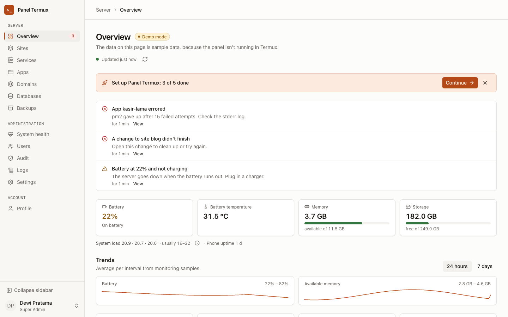

- [Highlights](#highlights)
- [Problems it solves](#problems-it-solves)
- [Install on your phone](#install-on-your-phone)
- [Requirements and configuration](#requirements-and-configuration)
- [Language](#language)
- [CLI commands](#cli-commands)
- [Troubleshooting](#troubleshooting)
- [Backup and restore](#backup-and-restore) · [Rollback](#rollback) · [Security](#security) · [Development](#local-development)

## Highlights

**Built for phone screens.** Every page is comfortable to use from a phone, with a bottom navigation bar and dark mode. The overview shows problems first, or "All healthy".

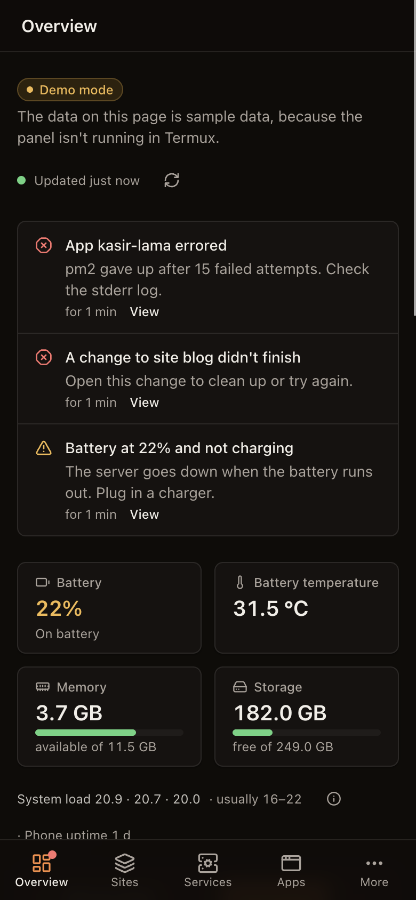

**The panel fixes things itself.** **Sites → Setup** checks the pm2 integration and shows one row per problem. The **Fix** or **Fix all** button first explains the change in plain language, with a diff under **Show the file changes**. A copy of the old file is kept, and **Undo change** restores it. No need to open `nano` in Termux. Details in [pm2 integration](#pm2-integration-appsjson).

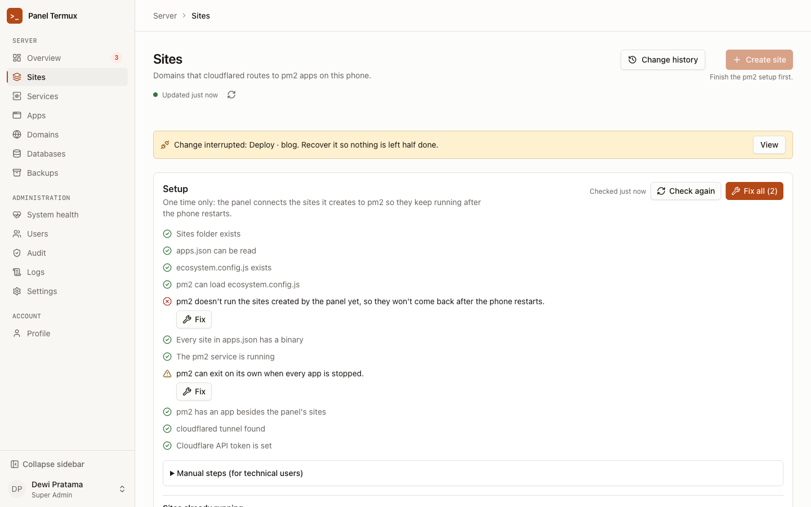
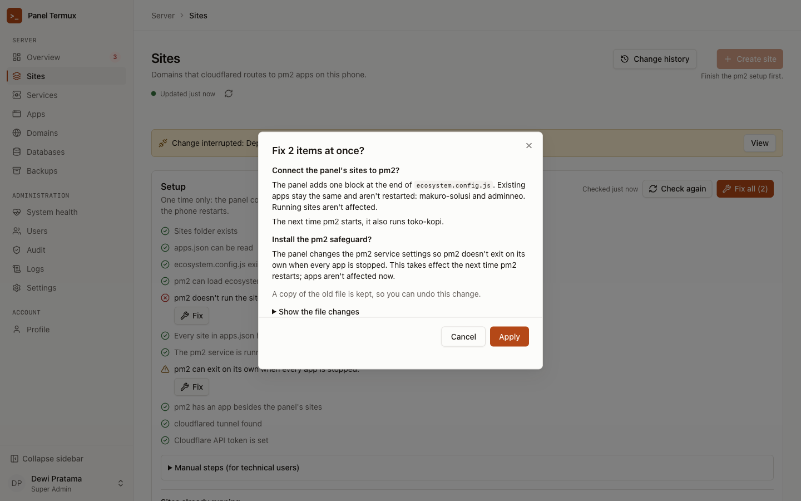

**Safe binary deploys.** Upload a Bun binary from the browser. An interrupted upload can be resumed (**Resume upload**). The panel waits until the app is healthy, and if it is not healthy within the time limit, the deploy is rolled back automatically. **Restore previous version** is available at any time. See [Deploying binaries](#deploying-binaries).

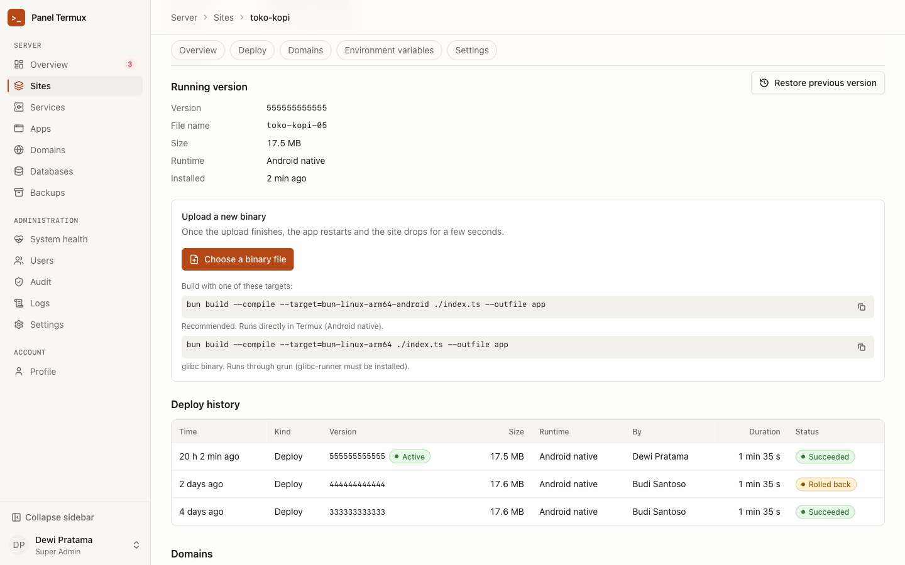

**New-site wizard with automatic DNS.** Fill in the name, hostname, port, and an optional database. The panel creates the folder, database, `.env`, pm2 entry, tunnel ingress, and DNS CNAME in one go, and undoes earlier steps if one step fails. See [Creating a site](#creating-a-site).

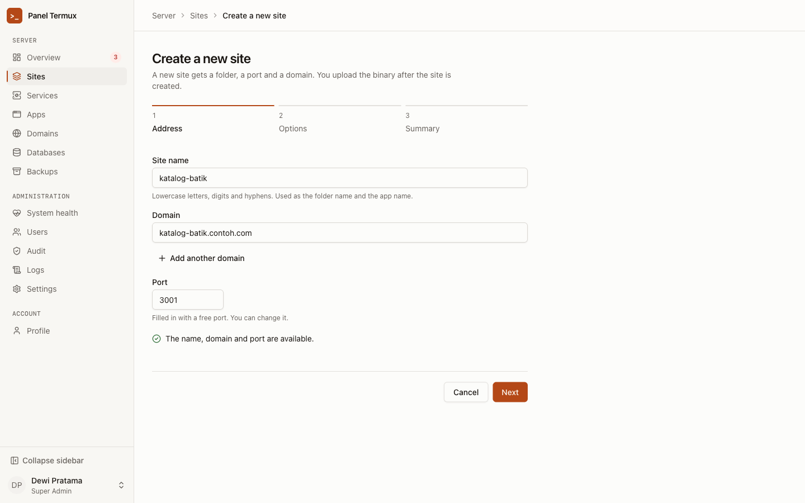

**Daily backups to S3/R2 with restore tests.** Postgres databases, site folders, tunnel configuration, and `panel.db` are uploaded every day with checksums and retention. **Restore to a new database** proves a backup can be restored without touching the original database. See [Backup and restore](#backup-and-restore).

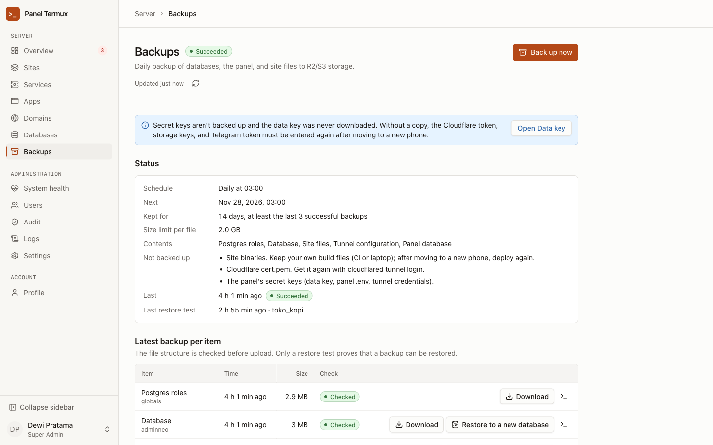

**Monitoring and Telegram notifications.** A sampler reads battery, memory, storage, services, apps, and domains every 60 seconds (configurable). New problems, problems that get worse, and problems that recover are sent to Telegram, in English or Indonesian. See [Monitoring and notifications](#monitoring-and-notifications).

**System health and setup.** The super admin sees setup cards (Cloudflare Access, data key, backups, Cloudflare token, first site, admin) with their progress, and the state of the panel, on one page.

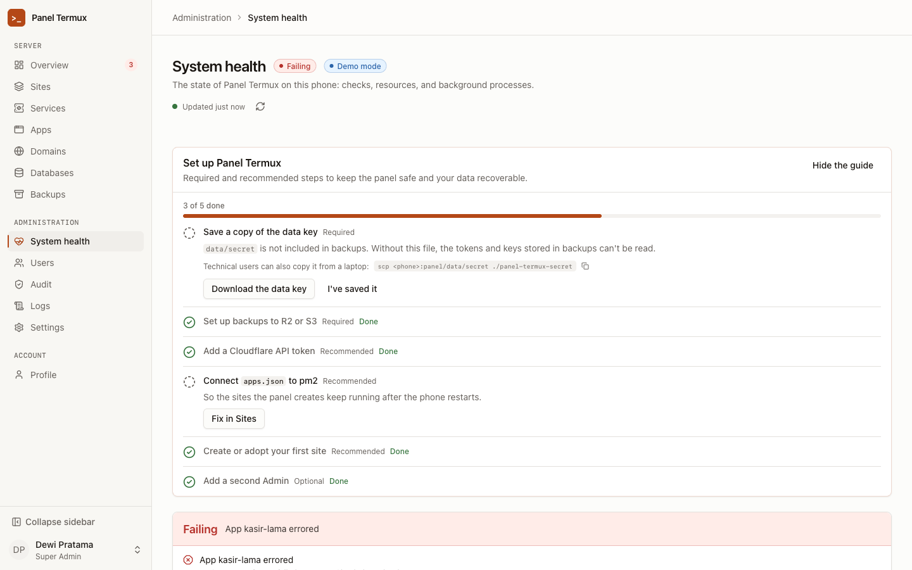

**A readable audit log.** Every change is recorded: who, when, from which device, in plain sentences. It can be filtered and exported as CSV.

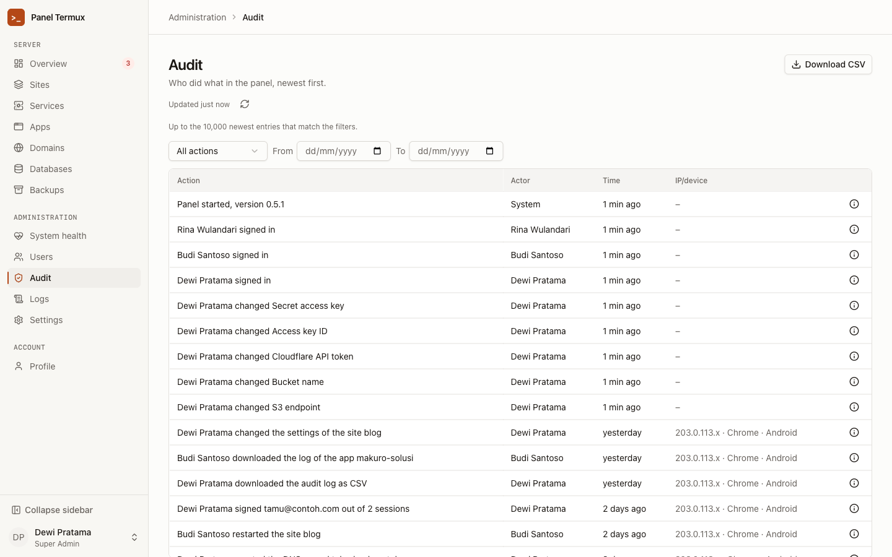

**Settings from the browser.** The Cloudflare token, S3/R2 keys, and Telegram bot are entered under Settings, with connection test buttons. Secret values are stored encrypted and never shown again.

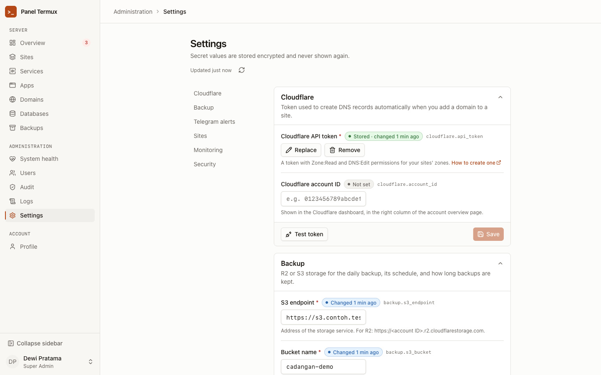

**Secure by default.** The panel only listens on `127.0.0.1` and is reached through Cloudflare Tunnel. Private paths are protected by Cloudflare Access, requests that change data are guarded against CSRF, and roles (`user`, `admin`, `super_admin`) are checked on the server. See [Security](#security).

**Public product page.** `/` introduces the panel to visitors, complete with the install line and a "Sign in with Google" button.

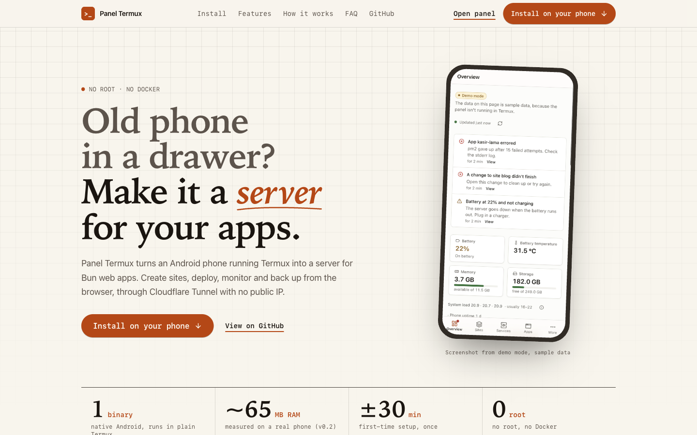

**One install line, one check command.** `panel init` takes an empty Termux all the way to a running panel. `panel doctor` checks the phone without changing anything and names the next step for each problem.

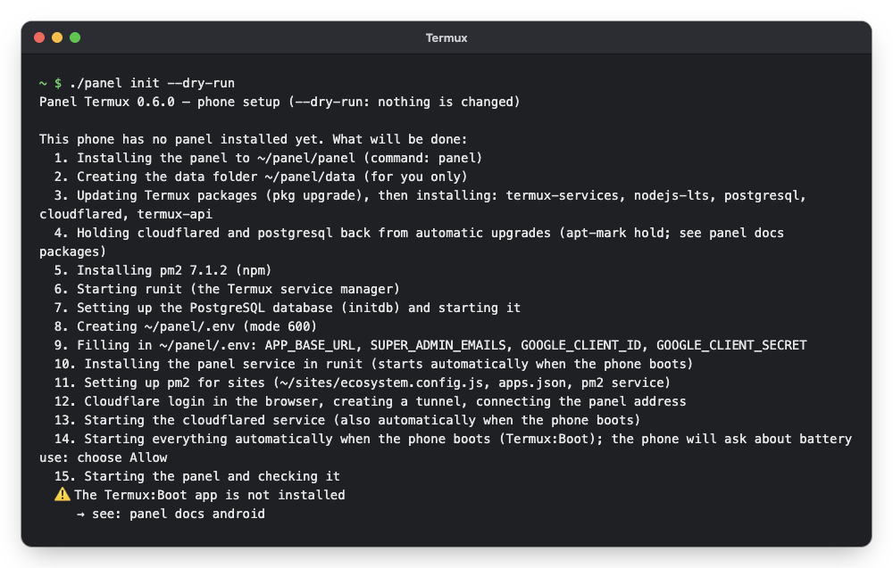
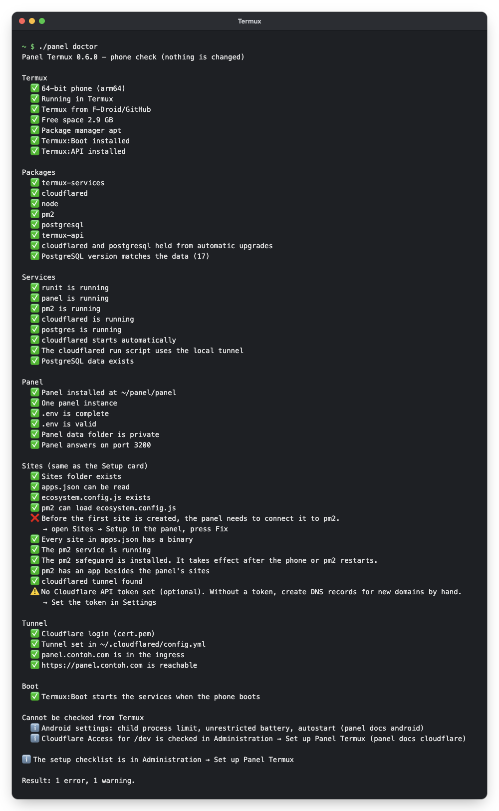

## Problems it solves

- **A spare phone becomes a server without root or Docker.** Bun apps are compiled to a single binary and run by pm2 in Termux; public domains go through Cloudflare Tunnel, with no public IP or port forwarding.
- **No Termux commands to memorize.** Installation is one line; after that, services, sites, domains, and databases are managed from the browser. Setup problems are fixed with the **Fix** button, not by editing files.
- **Deploys do not take sites down.** The old binary is kept, app health is checked, and a failed version is rolled back automatically.
- **No data loss if the phone breaks or is stolen.** Daily backups to S3/R2 with a [Restore to a new phone](#restore-to-a-new-phone) runbook.
- **Know when something breaks.** Overview, problem history, and Telegram notifications for battery, stopped services, crashing apps, unresponsive domains, and stale backups.
- **Upgrades without breaking the phone.** `pkg upgrade` is never run while PostgreSQL data exists, `cloudflared` and `postgresql` are held, and the panel can be [rolled back](#rollback).

<a id="instal-di-hp"></a>

## Install on your phone

In short: set up the Android apps, create a Google OAuth client, run one line in Termux, then protect the private paths with Cloudflare Access.

1. **Android apps.** Install Termux, Termux:Boot, and Termux:API from the same source (F-Droid or GitHub, not the Play Store). Open Termux:Boot once. Details and battery settings: `panel docs android` or [docs/cli/android.md](docs/cli/android.md).

2. **Google OAuth client.** Create a client of type Web application with the redirect URI `https://<panel address>/api/auth/callback/google`. Steps in [Google OAuth client](#google-oauth-client).

3. **Run this one line in Termux.** The same line installs on a new phone, upgrades, and repairs:

   ```sh
   cd && curl -fL --retry 3 -o panel-termux https://github.com/makurosolusi/panel-termux/releases/latest/download/panel && chmod +x panel-termux && ./panel-termux init
   ```

   This line only works from v0.5.1 on (earlier releases have no `panel` asset). For a specific version, replace `latest/download` with `download/<tag>`. To see the plan first without changing anything: `./panel-termux init --dry-run`.

   `panel init` installs the binary to `~/panel/panel`, then sets up packages, runit, PostgreSQL, `~/panel/.env`, the panel service, pm2, the cloudflared tunnel, Termux:Boot, and starts the panel. Before changing anything, init prints its plan and asks for approval. It is safe to run again: what already exists is not overwritten. It asks for (only what is still empty):
   - **Language / Bahasa** for the CLI (asked once, saved as `PANEL_LANG`);
   - **panel address**, e.g. `panel.example.com` (becomes `APP_BASE_URL`);
   - **admin Google email** (`SUPER_ADMIN_EMAILS`);
   - **Google Client ID and secret**. Init prints the redirect URI to paste into the OAuth client's "Authorized redirect URIs", namely `https://<address>/api/auth/callback/google`;
   - **Cloudflare login**: init prints a cloudflared login link; open it, click, and choose the domain. Init then creates or reuses a tunnel, adds the panel hostname to `~/.cloudflared/config.yml`, and creates its DNS.

   `.env` answers are saved immediately (mode 600) and their values are never printed. If interrupted midway, run the same line again: init continues with what is still missing. Follow the notes printed at the end (battery permission, open Termux:Boot once).

   **Upgrading** = running the same line again. Only the binary is swapped (the old version is kept as `panel.prev`) and the panel service is restarted. Afterwards open **Sites → Setup**: if anything needs adjusting, press **Fix all** there.

   `panel init` options:

   | Option                            | Purpose                                                                                              |
   | --------------------------------- | ---------------------------------------------------------------------------------------------------- |
   | `-y`, `--yes`                     | Answer yes to the plan, including restarting the panel on upgrade (for scripts without a terminal).  |
   | `--dry-run`                       | Only print the plan; nothing is changed.                                                             |
   | `--hostname <domain>`             | Panel address, not asked again.                                                                      |
   | `--admin-email <email>`           | Super admin Google email; may be repeated.                                                           |
   | `--skip <postgres\|tunnel\|boot>` | Skip one part; may be repeated.                                                                      |
   | `--ssh-key <https-url\|file\|->`  | Add an SSH key from an `https://` URL, a file, or `-` (paste), then enable sshd with key-only login. |
   | `--skip-verify`                   | Skip the self-check against the release's `SHA256SUMS`. Terminal only, with confirmation.            |
   | `--lang <en\|id>`                 | CLI language for this run (any command accepts it); without it, init asks once.                      |

   <details>
   <summary>Init modes, what init protects, and the self-check</summary>

   The mode is chosen from the phone's state:
   - **New phone** (no PostgreSQL, `~/.cloudflared`, `~/.pm2`, `~/sites`, or `panel.db` yet): all steps.
   - **Upgrade** (this binary is newer than the installed one): only the binary is swapped and the panel service restarted.
   - **Repair** (same version): only completes what is missing. Packages, PostgreSQL, and Termux:Boot need a terminal.

   A binary older than the installed one is refused; to go back use [`panel rollback`](#rollback).

   What init protects:
   - `pkg upgrade` only on a new phone without PostgreSQL. If PostgreSQL data exists, there is never a `pkg upgrade`, and installing packages that would replace `cloudflared`, `postgresql`, or `nodejs` is refused. `cloudflared` and `postgresql` are held from `pkg upgrade`, see `panel docs packages`.
   - A hand-written `ecosystem.config.js` and an existing pm2 setup are not touched. Anything that needs adjusting is done through **Sites → Setup → Fix**.
   - DNS records pointing to another tunnel are only moved after you answer yes in the terminal.
   - pm2 is never restarted. The panel is only restarted on upgrade; in other modes a running panel is left alone.

   If a site change is in progress (deploy, create site, etc.), the panel restart during an upgrade waits for it to finish, **up to 2 minutes**. During that time the panel is unreachable. Changes not finished after 2 minutes are interrupted and shown as "Interrupted" in Change history, with a **Recover** button to clean them up.

   **Self-check**: before installing, init matches itself against the `panel` line in its release's `SHA256SUMS` (downloaded over HTTPS). This proves the download is intact, not where the release came from. To verify the release's origin (optional, on a computer): `gh attestation verify panel --repo makurosolusi/panel-termux`.

   `install.sh` from older releases remains as a shim through 0.6.x: it downloads `panel`, checks it against `SHA256SUMS`, then runs `panel init` (removed in 0.7.0). `scripts/install-phone.sh` has been removed.

   </details>

4. **Protect the panel's private paths with Cloudflare Access.** The landing page `/`, the Google sign-in flow, and `/profile` deliberately stay public.

   In the Cloudflare dashboard: **Zero Trust → Access controls → Applications → Create new application → Self-hosted and private**. Create **one** application, then **Add public hostname** once per path (the domain `panel.<domain>` is the same for all):

   | Path (**Path** field) | Protects                                        |
   | --------------------- | ----------------------------------------------- |
   | `panel`               | pages `/panel` and `/panel/...`                 |
   | `dev`                 | pages `/dev` and `/dev/...`                     |
   | `api/panel`           | API `/api/panel/...` (including deploy uploads) |
   | `api/dev`             | API `/api/dev/...`                              |

   Write paths **without** `/*`: according to the Access documentation, `panel/*` only covers `/panel/<something>` and does **not** cover `/panel` itself, while `panel` covers the path and its sub-paths. Leaving the Path field empty protects the whole hostname, including the landing page, so do not do that. Query strings are not supported in Access paths (not a problem, the panel does not use them for routing).

   Add one **Allow** policy with the **Emails** selector containing the panel owner's email (more than one is fine), then **Create**. When you make someone an Admin, add their email to the Access policy too.

   Access is only the front layer. Behind it the panel's Google sign-in and roles still apply, and `/api/panel/*` and `/api/dev/*` are still guarded by roles on the server even if Access is misconfigured. System health shows "Cloudflare Access not detected yet" until the panel sees a request to `/api/panel` or `/api/dev` carrying an Access token.

   <details>
   <summary>What is deliberately not protected by Access, and how Access sign-in behaves in the SPA</summary>

   What is deliberately **not** protected by Access, and why:
   - `/` (landing page) and `/login`: must be open to anyone.
   - `/profile`: only shows your own account from `/api/me`, and a different Google account that signs in needs to see the "doesn't have access to this panel yet" explanation there.
   - `/api/auth/...`: Google sign-in and the Better Auth callback; if protected, signing in from the landing page does not work for visitors.
   - `/api/me`: called by the landing page for visitors (answers 401 when not signed in); if protected, its fetch is redirected to the Access login page and the landing page fails to load.
   - `/api/health` and the bundle assets at the root (`/chunk-*.js`, `/chunk-*.css`): contain no data, and the landing page needs them.

   Practical effect because the panel is an SPA: Access can only show its login page when the browser loads a full page on a protected path. That is why moving from a public page to the private area (the "Open panel" button on `/`, and the redirect from `/login` to the role's home page after Google sign-in) deliberately does a full page load, so Access gets a chance to ask for login; navigation inside `/panel`, `/dev`, `/profile` stays client-side. For an Access session that expires (24 hours by default) while the panel is open, every panel API call sends the header `X-Requested-With: XMLHttpRequest`, so Access answers `401` (instead of redirecting to its login domain); the panel then reloads the page once automatically and Access shows its login. If Access still refuses within 30 seconds after the reload, the panel stops reloading and shows a message: open `https://panel.<domain>/panel` (or `/dev`) directly in the address bar, and check whether your email is allowed in the Access policy. After the Access login, the `CF_Authorization` cookie applies to that hostname and navigation inside the panel works normally until the Access session ends.

   </details>

### Install from source

Without a release (e.g. to test your own build), copy the binary to the phone and run `init` from there:

```sh
bun run build
rsync --partial dist/panel-android-arm64 poco: && ssh poco 'PANEL_DEV_INSTALL=1 ./panel-android-arm64 init --yes'
```

A local build has no release tag, so it cannot be checked against `SHA256SUMS`, and `init` refuses it unless `PANEL_DEV_INSTALL=1` is set. `--yes` approves the plan and the panel restart without a terminal; `.env` questions that are still unanswered stay empty and the panel is held with a `down` file until you run `init` in a terminal.

## Requirements and configuration

### Requirements

- **Phone**: 64-bit Android (arm64). Termux from F-Droid/GitHub, plus Termux:Boot and Termux:API from the same source. `panel init` installs the rest: `termux-services` (runit), `pm2` run by runit and reading `~/sites/ecosystem.config.js` (see [pm2 integration](#pm2-integration-appsjson)), `cloudflared` as a runit service with `~/.cloudflared/config.yml`, local PostgreSQL (role `postgres`, or set `PGUSER`), and `curl`. `grun` is only needed for sites with a glibc binary. The [server-termux](https://github.com/makurosolusi/server-termux) repo can also prepare the phone.
- **A domain on Cloudflare** (for the tunnel, DNS, and Access).
- **A Google Cloud account** for the OAuth client.
- **Development**: [Bun](https://bun.sh) (the version in `bun.lock`/`@types/bun`), macOS/Linux.

### Google OAuth client

1. console.cloud.google.com → APIs & Services → Credentials → Create credentials → OAuth client ID, type **Web application**.
2. Authorized redirect URIs:
   - `${APP_BASE_URL}/api/auth/callback/google`, e.g. `https://panel.example.com/api/auth/callback/google`
   - for local development: `http://localhost:3200/api/auth/callback/google` (adjust the port)
3. Copy the Client ID and Client secret into `.env` (or answer the `panel init` questions).

Google only accepts public https domains or `localhost`; a Tailscale/LAN IP cannot be used as `APP_BASE_URL`. Offline guide: `panel docs google`.

### Configuration (env)

`~/panel/.env` on the phone (created by `panel init`, mode 600). Print an empty template with `panel env`; `panel env --full` adds the optional variables, commented out. See also `.env.example`.

| Variable                 | Required | Default                                | Meaning                                                                                                                                                                 |
| ------------------------ | -------- | -------------------------------------- | ----------------------------------------------------------------------------------------------------------------------------------------------------------------------- |
| `APP_BASE_URL`           | yes      | –                                      | Public address of the panel (`https://domain`, or `http://localhost:<port>` locally). Used for the OAuth redirect.                                                      |
| `GOOGLE_CLIENT_ID`       | yes      | –                                      | Google OAuth Client ID (type Web application).                                                                                                                          |
| `GOOGLE_CLIENT_SECRET`   | yes      | –                                      | Google OAuth client secret. Secret.                                                                                                                                     |
| `SUPER_ADMIN_EMAILS`     | yes      | –                                      | Google emails that become super admin, comma-separated.                                                                                                                 |
| `PORT`                   | no       | `3200`                                 | Panel port (always listens on `127.0.0.1` only).                                                                                                                        |
| `PANEL_DATA_DIR`         | no       | `./data`                               | Relative to the working dir. Holds `panel.db`, `secret` (data key), `snapshots/`, `fix-backups/` (file copies taken before Setup fixes), and unfinished deploy uploads. |
| `PANEL_CONNECTIVITY_URL` | no       | `https://www.gstatic.com/generate_204` | URL the sampler checks to tell "no internet" from "site down". Change it if that address is blocked on your network.                                                    |
| `PANEL_SKIP_SNAPSHOT`    | no       | `0`                                    | `1` = migrate anyway when the pre-migration snapshot fails (e.g. storage full). For one start only; remove it afterwards. See [Rollback](#rollback).                    |
| `PANEL_LANG`             | no       | `en`                                   | CLI language: `en` or `id`. `panel init` asks once and writes it here. See [Language](#language).                                                                       |

Bun loads `.env` automatically from the working directory. The panel refuses to start and names the variable (not its value) if one is empty or invalid. `PANEL_DEV_INSTALL=1` is not a `.env` variable: it is only set when running `init` with a local build ([Install from source](#install-from-source)).

### Settings in the panel

All other settings are entered under **Administration → Settings** (`/dev/settings`), in six groups. Each group is saved at once; secret values are stored encrypted with the data key and never shown again. The Cloudflare, Backup, and Telegram alerts groups have connection test buttons.

<details>
<summary>Full list of settings</summary>

| Group           | Key                            | Label in the panel         | Default                               | Notes                                                                                                                                                                                                                    |
| --------------- | ------------------------------ | -------------------------- | ------------------------------------- | ------------------------------------------------------------------------------------------------------------------------------------------------------------------------------------------------------------------------ |
| Cloudflare      | `cloudflare.api_token`         | Cloudflare API token       | –                                     | Secret. Permissions **Zone:Read** and **DNS:Edit** (look up the zone and create the site CNAME to the tunnel). Without a token, the DNS step is skipped and the record is created manually. Can be tested before saving. |
| Cloudflare      | `cloudflare.account_id`        | Cloudflare account ID      | –                                     | 32 hex. Needed to verify account-owned tokens.                                                                                                                                                                           |
| Backup          | `backup.s3_endpoint`           | S3 endpoint                | –                                     | Path-style, e.g. `https://<account>.r2.cloudflarestorage.com`.                                                                                                                                                           |
| Backup          | `backup.s3_bucket`             | Bucket name                | –                                     | Target bucket.                                                                                                                                                                                                           |
| Backup          | `backup.s3_region`             | Region                     | `auto`                                | R2 uses `auto`.                                                                                                                                                                                                          |
| Backup          | `backup.s3_access_key_id`      | Access key ID              | –                                     | Secret.                                                                                                                                                                                                                  |
| Backup          | `backup.s3_secret_access_key`  | Secret access key          | –                                     | Secret.                                                                                                                                                                                                                  |
| Backup          | `backup.prefix`                | Folder prefix              | `panel-termux/`                       | Retention only deletes under this prefix. Must end with `/`. Use a different prefix if several phones share one bucket.                                                                                                  |
| Backup          | `backup.hour`                  | Daily backup time          | `3`                                   | Local hour (0-23), or `off` for manual only.                                                                                                                                                                             |
| Backup          | `backup.retention_days`        | Keep backups (days)        | `14`                                  | 1-365. See [Retention](#backup-and-restore).                                                                                                                                                                             |
| Backup          | `backup.keep_min_runs`         | Minimum successful backups | `3`                                   | 1-50. Number of latest successful runs that retention never deletes.                                                                                                                                                     |
| Backup          | `backup.max_item_mb`           | Size limit per file (MB)   | `2048`                                | Larger backup files are not uploaded and are flagged in the history.                                                                                                                                                     |
| Backup          | `backup.include_secrets`       | Include secret keys        | `off`                                 | `on` = the data key, panel `.env`, and tunnel credentials go to the bucket too. Anyone who can read the bucket can take over the panel. Turning it on needs a fresh session.                                             |
| Telegram alerts | `alerts.enabled`               | Telegram alerts            | `on`                                  | Turn off temporarily without deleting the token.                                                                                                                                                                         |
| Telegram alerts | `alerts.telegram_bot_token`    | Telegram bot token         | –                                     | Secret. From @BotFather.                                                                                                                                                                                                 |
| Telegram alerts | `alerts.telegram_chat_id`      | Telegram chat ID           | –                                     | Numeric ID or `@channel`. The "Find chats" button fills it in after you send a message to the bot.                                                                                                                       |
| Telegram alerts | `alerts.language`              | Telegram language          | `en`                                  | `en` or `id`. Set to `id` automatically for panels that had Telegram set up before 0.6.0.                                                                                                                                |
| Telegram alerts | `alerts.min_severity`          | Alert level                | `warning`                             | `warning` (all problems, warnings sent silently) or `danger` (critical only).                                                                                                                                            |
| Sites           | `sites.dir`                    | Sites folder               | `~/sites`                             | `apps.json` and `ecosystem.config.js` live here.                                                                                                                                                                         |
| Sites           | `sites.port_range`             | Site port range            | `3001-3999`                           | Local ports for new sites.                                                                                                                                                                                               |
| Monitoring      | `monitor.sample_interval_sec`  | Check interval (seconds)   | `60`                                  | 30-600. Larger = less battery and fewer flash writes.                                                                                                                                                                    |
| Monitoring      | `monitor.battery_warn_percent` | Battery warning below (%)  | `25`                                  | 16-100 or `off`. Only while the phone is not charging; below 15% is always severe.                                                                                                                                       |
| Security        | `panel.protected_services`     | Core services              | `sshd,cloudflared,panel,pm2,postgres` | Can only be stopped by typing their name. `panel` and `cloudflared` can never be stopped from the panel, even if removed from the list.                                                                                  |
| Security        | `audit.retention_days`         | Keep audit log (days)      | `365`                                 | 90-3650. Older entries are deleted automatically (at boot and daily).                                                                                                                                                    |

</details>

Cloudflare Access protects the paths `panel`, `dev`, `api/panel`, and `api/dev` (step 4 in [Install on your phone](#install-on-your-phone)).

## Language

The web panel, the landing page, the CLI, Telegram alerts, and the offline guides are in English by default. Indonesian (Bahasa Indonesia) is available everywhere:

- **Web panel**: **Profile → Language** offers English, Bahasa Indonesia, or Use device language. The choice is saved to your account, so your other signed-in devices follow it the next time they open the panel. Without a choice, the panel follows the browser language and falls back to English.
- **Before signing in**: the login page and the bottom of the landing page link to the other language. Adding `?lang=id` or `?lang=en` to any panel address works too; that choice is remembered in the browser.
- **CLI**: `panel init` asks **Language / Bahasa** once and saves `PANEL_LANG` in `~/panel/.env`. Every command also accepts `--lang en|id`, and `PANEL_LANG=id` in the environment works for one shell. Without either, the CLI follows `LC_ALL`/`LC_MESSAGES`/`LANG`, then English. Upgrading from 0.5.x and want to keep the Indonesian CLI: set `PANEL_LANG=id` in `~/panel/.env`.
- **Telegram alerts**: **Telegram language** under Settings → Telegram alerts. Panels that had Telegram set up before 0.6.0 keep Indonesian after the upgrade.

Things that stay English in every language: the audit CSV header, the data key file, and the comments in the ecosystem block.

Page anchors are English since 0.6.0: Sites `#setup`, `#overview`, `#not-managed`; Administration (`/dev`) `#setup`, `#data-key`; Settings `#backup`, `#alerts`, `#sites`, `#monitor`, `#security`; landing `#install`, `#features`, `#how-it-works`, `#limits`, `#screens`. The 0.5.x Indonesian anchors (`#persiapan`, `#kunci-data`, `#cadangan`, `#pasang`, …) still land on the same place during 0.6.x, and `?akun=dihapus` is still accepted next to `?account=deleted`.

## CLI commands

The same binary also has commands for the terminal. Run them from `~/panel` (`cd ~/panel && ./panel <command>`):

| Command                         | Purpose                                                                                                                                                                                                                                                                                  |
| ------------------------------- | ---------------------------------------------------------------------------------------------------------------------------------------------------------------------------------------------------------------------------------------------------------------------------------------- |
| `panel -h`, `--help`, `--h`     | Help; `panel <command> --help` for a single command.                                                                                                                                                                                                                                     |
| `panel -v`, `--version`, `--v`  | Version, e.g. `panel-termux 0.6.0 (android-arm64, bun 1.x)`.                                                                                                                                                                                                                             |
| `panel init [options]`          | Install, upgrade, or repair the panel on this phone, see [Install on your phone](#install-on-your-phone). Try `--dry-run` first.                                                                                                                                                         |
| `panel serve`                   | Runs the server. runit still runs `panel` without arguments; in a terminal, `panel` without arguments only prints help.                                                                                                                                                                  |
| `panel doctor [--json]`         | Checks the phone without changing anything: packages and holds, Termux:Boot/API, runit, `.env`, duplicate panels, Setup cards (with the same messages), tunnel, PostgreSQL version. Exit code 1 only if there is a ❌.                                                                   |
| `panel env [--full]`            | Prints an empty `.env` template to stdout (also `panel --env`). Write it to a new file (`panel env > .env.new`); appending to a `.env` that already has content (`>>`) is refused.                                                                                                       |
| `panel docs [topic]`            | Offline guides: `google`, `cloudflare`, `android`, `packages` (why `cloudflared` and `postgresql` are held from `pkg upgrade`, and how to upgrade them safely; the old name `paket` still works). Sources in [docs/cli](docs/cli) (English) and [docs/cli/id](docs/cli/id) (Indonesian). |
| `panel rollback [--db] [--yes]` | Go back to the previous binary, see [Rollback](#rollback).                                                                                                                                                                                                                               |

Every command accepts `--lang en|id` ([Language](#language)). Exit codes: 0 success, 1 failure, 2 usage error, 3 action needed then retry, 4 cancelled (`init` also 130 for Ctrl-C). CLI commands do not pass the panel's `.env` contents to the programs they run.

## Troubleshooting

First step for any problem: `cd ~/panel && ./panel doctor`. Every ❌/⚠️ is followed by the next step (→). Over ssh, first set `export SVDIR=$PREFIX/var/service` before using `sv`.

| Symptom                                                                       | Cause                                                                                                                                                                   | Fix                                                                                                                                                                                                                                                |
| ----------------------------------------------------------------------------- | ----------------------------------------------------------------------------------------------------------------------------------------------------------------------- | -------------------------------------------------------------------------------------------------------------------------------------------------------------------------------------------------------------------------------------------------- |
| The panel cannot be opened from outside (error 1033/502 from Cloudflare)      | The `cloudflared` tunnel or the panel service is down, or the hostname is not in `~/.cloudflared/config.yml` yet.                                                       | `sv status cloudflared panel` (must be `run:`). `panel doctor` checks the tunnel; run the install line again to complete the hostname and DNS. Guide: `panel docs cloudflare`.                                                                     |
| `/panel` keeps asking for the Access login, or is refused                     | The email is not allowed in the Access policy, or the Access session expired (24 hours by default).                                                                     | Add the email to the Access policy. Open `https://panel.<domain>/panel` directly in the address bar. Check that Access paths are written without `/*` ([step 4](#install-on-your-phone)).                                                          |
| The landing page `/` asks for the Access login                                | The Access application's Path field was left empty, so the whole hostname is protected.                                                                                 | Fill in a Path per hostname: `panel`, `dev`, `api/panel`, `api/dev`.                                                                                                                                                                               |
| Google sign-in fails (`redirect_uri_mismatch`)                                | The redirect URI in the OAuth client does not exactly match `APP_BASE_URL`.                                                                                             | Add `<APP_BASE_URL>/api/auth/callback/google` to Authorized redirect URIs ([Google OAuth client](#google-oauth-client)). Scheme, domain, and port must match. Google does not accept LAN/Tailscale IPs.                                            |
| Sign-in works but you only see "doesn't have access to this panel yet"        | New accounts start as `user`.                                                                                                                                           | The super admin changes the role under **Administration → Users**, or add the email to `SUPER_ADMIN_EMAILS` then `sv restart panel`.                                                                                                               |
| The panel does not start, the log names an env variable                       | A required variable is empty or invalid.                                                                                                                                | Run the install line again: init asks for what is empty. Compare with `panel env --full`.                                                                                                                                                          |
| `panel serve` exits with code 1: another panel already answers on the port    | The panel run by runit is alive; a second panel refuses to start before touching any data.                                                                              | Use `sv restart panel`, not `panel serve`.                                                                                                                                                                                                         |
| The **Sites → Setup** card is red                                             | `ecosystem.config.js`, `apps.json`, the pm2 run script, or the site folder is not right yet (e.g. a 0.2.x snippet).                                                     | Press **Fix** or **Fix all**. If the file cannot be changed safely, that row opens **Manual steps**. See [pm2 integration](#pm2-integration-appsjson).                                                                                             |
| pm2 stops and takes all apps down with it                                     | pm2 run script without `--no-auto-exit`, a 0.2.x `apps.json` snippet (one missing binary stops all apps), or an ecosystem with no apps because `pm2-guard` was removed. | **Fix** in Setup adds `--no-auto-exit` and the panel block; do not remove `pm2-guard`. Pages that need pm2 offer **Start pm2**.                                                                                                                    |
| `pkg upgrade` skips `cloudflared`/`postgresql`                                | Both are deliberately held because upgrading them kills the tunnel or makes the database unreadable.                                                                    | Follow `panel docs packages` for a safe upgrade. Do not `pkg upgrade` to fix "installed incomplete" packages; use `dpkg --configure -a`.                                                                                                           |
| The server dies when the screen is off or after the phone restarts            | Android battery optimization, Termux:Boot never opened, wake-lock not active, or the phantom process killer.                                                            | Follow `panel docs android`: battery "Unrestricted" for Termux, Termux:Boot, Termux:API (Xiaomi/POCO: Autostart), open Termux:Boot once, allow wake-lock, disable the phantom process killer (Android 12+). After a reboot, unlock the phone once. |
| Deploy cancelled: app not healthy                                             | The app did not answer the health check within the time limit, or pm2 restarted it.                                                                                     | The deploy has already been rolled back to `app.prev`. Check the log in **Change history**, check the health check path/status/time limit in the site details, then deploy again. See [Deploying binaries](#deploying-binaries).                   |
| Deploy upload interrupted                                                     | The network dropped or the page was reloaded.                                                                                                                           | **Resume upload** within 1 hour. Needs free space equal to the file size + 200 MB.                                                                                                                                                                 |
| Backup fails                                                                  | The S3/R2 endpoint, bucket, or keys are wrong, or the token lacks a needed permission.                                                                                  | **Settings → Backup → Test connection**, then **Back up now**. Retention being refused by a token without delete permission is expected ([Backup and restore](#backup-and-restore)).                                                               |
| "The data key doesn't match"                                                  | `PANEL_DATA_DIR/secret` is missing or swapped.                                                                                                                          | Restore the old file, or choose "Delete old secret settings" and re-enter them ([Data key](#data-key)).                                                                                                                                            |
| `panel init` exits with code 3                                                | A step needs action in the terminal (Cloudflare login, moving DNS, restarting cloudflared, approving the plan).                                                         | Run the same line in the Termux app (not ssh without `-t`) and follow its messages.                                                                                                                                                                |
| `panel init` exits with code 1                                                | Problems remain at the end; init prints the list with hints.                                                                                                            | Follow those hints, then run the same line again. If the new panel fails to start: [`panel rollback`](#rollback).                                                                                                                                  |
| The panel does not start after an upgrade, the log mentions a failed snapshot | The pre-migration snapshot failed, usually because storage is full.                                                                                                     | Free up space, or set `PANEL_SKIP_SNAPSHOT=1` in `~/panel/.env` for one start and then remove it. Or `panel rollback`.                                                                                                                             |
| Upgrade refused: binary is older                                              | The binary being run is older than the installed one.                                                                                                                   | To go back to an older version use `panel rollback`.                                                                                                                                                                                               |

### Rollback

`panel init` prints these instructions if the new panel fails to start:

```sh
~/panel/panel rollback        # swap panel <-> panel.prev, then restart the panel service
~/panel/panel rollback --db   # also restore panel.db from the latest snapshot
```

The swap never makes `~/panel/panel` disappear, even if the phone dies midway, and `panel.prev` is never executed. Rolling back twice = back to the new version. If the database has already been migrated by the new version, `panel rollback` warns about it; `--db` copies the latest snapshot to `panel.db` (data changes after the snapshot time are lost), after first saving the current `panel.db` as `snapshots/panel.db.before-rollback.<time>`. `before-rollback` copies are not removed by snapshot rotation; delete them yourself when no longer needed. Without a terminal (scripts), add `--yes`. After going back to 0.4.0 or older, do not run `~/panel/panel` with any arguments: the old binary ignores them and starts a second panel. To move up again, run the install line in [Install on your phone](#install-on-your-phone) again.

The panel creates a snapshot `panel.db.<old version>.<time>` in `<PANEL_DATA_DIR>/snapshots/` (mode 600) every time boot finds new migrations for an existing database, and keeps the latest 3. If the snapshot fails (usually storage full), migrations are not run, the log names the cause, and the panel exits after 60 seconds so runit does not spin quickly. Free up space, or add `PANEL_SKIP_SNAPSHOT=1` to `~/panel/.env` for one start without a snapshot, then remove it again.

## Screens and roles

| Role          | Home page  | Contents                                                                                                                             |
| ------------- | ---------- | ------------------------------------------------------------------------------------------------------------------------------------ |
| `user`        | `/profile` | Own profile: active sessions, theme, delete account                                                                                  |
| `admin`       | `/panel`   | Overview, Sites (create/adopt/deploy/delete), runit Services, pm2 Apps, Domains, Databases, Backups, Change history, Problem history |
| `super_admin` | `/panel`   | Everything in `admin`, plus Administration at `/dev`: System health, Users, Audit, Logs, Settings                                    |

Higher roles can open all pages of the roles below them. The super admin also lands on `/panel`; Administration is in the side menu (on a phone: the **More** menu in the bottom bar).

`/` is the public introduction page (no sign-in); its button is "Sign in with Google" for visitors or "Open panel" to the role's home page when signed in. After Google sign-in, users return to `/login` and are forwarded to their role's home page. Unknown addresses answer 404: visitors see a public "Page not found" page with a link to `/`, signed-in users see a 404 inside the panel.

### Sign-in and roles

- Anyone with a Google account can sign in. New accounts start as `user` (only `/profile`, with a "doesn't have access to this panel yet" explanation).
- Emails in `SUPER_ADMIN_EMAILS` become `super_admin` on sign-in.
- Make someone admin under **Administration → Users** (change the role to `admin`). The `super_admin` role only comes from env. If the panel uses Cloudflare Access, add that email to the Access policy too.
- **Admins have full control of the phone.** An admin can deploy programs that run with the same access as the panel, so they can read all files, databases, and the data key, and then make themselves super admin. Only give the Admin role to people you trust like the phone's owner.
- Sign-in sessions last at most 30 days. Under **Profile** you can see and revoke active sessions and choose the language; the super admin can revoke other users' sessions and use "Sign out every user" in System health.
- Users with the `user` role can delete their own account from Profile. Audit records about that account are kept until they pass `audit.retention_days` (default 365 days).

## Monitoring and notifications

- One sampler reads the phone (battery, memory, storage, load), runit services, pm2 apps, domains, and backups every `monitor.sample_interval_sec` (default 60 seconds). **Overview** (`/panel`) shows problems first, or "All healthy". Idle CPU cost is about 1% on the test phone.
- Metric history (24-hour and 7-day battery/memory charts) and the last 30 checks per domain are kept for 7 days (±3 MB); problem history (`/panel/problems`) for 30 days. Flash writes are about 70-100 MB per day at the default interval; a larger interval cuts that.
- Battery level only counts as a problem when it is **low and not charging** (`monitor.battery_warn_percent`; below 15% is always severe); unplugging the charger by itself is not a problem. A hot battery is reported separately. A temperature that cannot be read is shown as "Not available", not 0 °C.
- An app that crashes repeatedly is only detected after the panel has been running for a few minutes, because the count is kept in memory.
- **Telegram**: create a bot with @BotFather, fill in **Telegram bot token** under Settings → Telegram alerts, send any message to the bot, then press **Find chats** and **Send test message**. **Telegram language** picks English or Indonesian for the messages. The panel sends one summary message per sampler round: when a problem appears, when it gets worse, a reminder if it is still open after 24 hours, and when it recovers. The same problem is not resent within 15 minutes, and the number of messages per hour is limited. "Backup isn't set up" and "Cloudflare Access not detected" are informational only and are not sent.
- The panel **cannot report its own death**. When it comes back up, the panel reports if the phone has just rebooted or the previous panel stopped abnormally. To know when the phone is down, use an external monitor (e.g. a periodic HTTP check to `https://panel.<domain>/api/health`).
- The log pages mask known secret values (site `.env` contents, tokens) before showing or downloading them. This masking is not perfect: do not write secrets to your app logs.

## pm2 integration (`apps.json`)

The panel owns `~/sites/apps.json` (created automatically at start if missing). For pm2 to run sites created by the panel, `~/sites/ecosystem.config.js` must include the entries from `apps.json`. The **Sites → Setup** page checks this (loading the ecosystem with `node` like pm2 does) and shows one row per problem.

**Fix from the panel.** When the panel can fix it itself, the row has a **Fix** button, and the card has **Fix all (n)**. The panel first shows what it means in plain language (hand-written apps that stay, panel sites that are added), with **Show the file changes** for the diff, then **Apply**:

- In `ecosystem.config.js` the panel only adds a block marked `panel-termux:apps v2` at the **end** of the file (and removes an old `...require("./apps.json")` if present). Hand-written apps are not changed or restarted. The `pm2-guard` keeper is only added when there are no hand-written apps. A `v1` block from 0.5.x still works (its code is the same, only the comments were Indonesian); Setup reports it as an older version and **Fix** replaces it.
- In the pm2 service run script the panel only adds `--no-auto-exit` after `pm2-runtime`. This takes effect at the next pm2 start (phone or pm2 restarted). **Restart pm2 now** (optional, asks for a confirmation that names the running apps) checks that all apps are running again; if not, the panel offers **Restore the ecosystem file and restart pm2**. If the restart would stop apps not listed in `ecosystem.config.js`, the confirmation names them and asks you to type `pm2`.
- Site folders that do not exist yet can be created from the same card. A broken `apps.json` is rebuilt from the panel's site list, and a missing `ecosystem.config.js` is created from the template [`deploy/pm2/ecosystem.config.js`](deploy/pm2/ecosystem.config.js). After a fix that takes effect at the next pm2 start, the card offers **Restart pm2 now**.
- Before writing, the panel validates the result with `node`; if that fails, the old file stays in use ("Not applied"). pm2 is never restarted by the fix itself.
- **Undo change** restores each changed file to its version before the fix (one undo per file). Copies are kept in `<PANEL_DATA_DIR>/fix-backups/`, the last 10 per file, only on the phone (not included in R2/S3 backups because the ecosystem can contain secret `env`).
- Files that cannot be changed safely (not UTF-8, symlink, broken block marker, `apps.json` used in another way) are not touched. The row states the reason and opens **Manual steps (for technical users)**.

<details>
<summary>Manual steps (for technical users)</summary>

New phones use the template [`deploy/pm2/ecosystem.config.js`](deploy/pm2/ecosystem.config.js) (an exact copy of `files/sites/ecosystem.config.js` in [server-termux](https://github.com/makurosolusi/server-termux), its source), which ends with the following part (copied from the file): the `panelApps` block, the `pm2-guard` keeper, and `apps` with `...panelApps` as its last element. Setup still considers this snippet correct:

```js
// Panel Termux: sites created by the panel are listed in apps.json (managed by the panel, do not edit by hand).
// Safe when apps.json is missing, empty or broken; entries whose binary does not exist yet are skipped,
// because one missing script makes pm2-runtime stop every app.
const panelApps = (() => {
  try {
    const fs = require("fs");
    const path = require("path");
    const list = require("./apps.json");
    return Array.isArray(list)
      ? list.filter(
          (a) => a && typeof a.name === "string" && fs.existsSync(path.resolve(a.cwd || __dirname, a.script || "")),
        )
      : [];
  } catch (e) {
    console.error(`[ecosystem] apps.json skipped: ${e.message}`);
    return [];
  }
})();

// pm2-runtime exits when the ecosystem has no app at start, even with --no-auto-exit.
// This keeper (sleep, ~1 MB) keeps it alive on a phone with no sites yet. Do not delete it.
const guard = {
  name: "pm2-guard",
  script: `${PREFIX}/bin/sleep`,
  args: "infinity",
  interpreter: "none",
  autorestart: true,
};

module.exports = {
  apps: [
    guard,
    // site('blog'),
    ...panelApps,
  ],
};
```

For hand-written files, the Manual steps section of the Setup card shows a ready-to-copy `panel-termux:apps v2` block to paste at the end of the file.

</details>

- The old `...require("./apps.json")` snippet from 0.2.x is flagged as an error in Setup. That snippet throws if `apps.json` is missing or broken, and one entry with a missing binary makes pm2-runtime stop **all** apps. **Fix** replaces it with the panel block.
- **Do not remove `pm2-guard`.** pm2-runtime exits if the ecosystem has no apps at start, even with `--no-auto-exit`. The `pm2-guard` keeper app (`sleep infinity`, ±1 MB) keeps it alive on phones that have no sites yet. The panel hides it from the Apps list.
- The `pm2` runit service should run `pm2-runtime --no-auto-exit` (see [`deploy/pm2/run`](deploy/pm2/run)). The panel never calls the `pm2` CLI while that service is down, so it does not start a second pm2 daemon; pages that need pm2 show "pm2 isn't running" with a **Start pm2** button (**Start postgres** for postgres). That button also removes the service's `down` file so the service starts again after the phone restarts.
- Sites recorded in the panel but missing from pm2 are marked "Not running in pm2" with a **Start again** button. Adopted sites are loaded from `ecosystem.config.js`.

## Creating a site

**Sites → Create site**: fill in the name, one or more hostnames, a port (suggested automatically from `sites.port_range`), an optional database, and extra `.env` variables. The wizard checks the name, port, and hostname as you type. The panel runs the change in stages: folder `~/sites/<name>` → Postgres database and role (optional, `DATABASE_URL` is written to `.env`) → `.env` (`PORT` filled in by the panel) → `apps.json` entry → `config.yml` ingress (validated by cloudflared first, backup `config.yml.bak`) → DNS CNAME → one cloudflared restart. If one step fails, earlier steps are undone. Per-step progress, duration, and logs are visible in **Change history** (`/panel/jobs`).

DNS is created through the Cloudflare API token if set. Without a token, the panel uses the phone's cloudflared login (`~/.cloudflared/cert.pem`, `cloudflared tunnel route dns`) and only accepts the result if cloudflared creates a record with exactly the same name; deleting that record later still needs a token. If neither is available, or cloudflared creates the record in another zone, the DNS step is skipped (the site is still created) and the panel shows a ready-to-copy record card (type, name, content, proxy) with **Check again**. The wizard summary states which DNS method will be used.

On the site details page: add/remove domains, edit environment variables (paste a `.env` with a preview; "Save" or "Save and restart", which restores the old values if the app fails to become healthy), restart, and health check settings (path, expected status, time limit 10-300 seconds, default 60).

Domain routes written manually in `config.yml` can also be removed from the site details: type the domain name to confirm. The panel only removes that route line; the rest of the config is not changed.

If a site folder is missing from the phone, deploying to a panel-created site without a database recreates that folder. For sites with a database or adopted sites, the panel does not guess their contents and shows guidance with **Delete site** and **Open Backups**.

Interrupted changes (panel restarted midway) show as "Interrupted" with a **Recover** button, which cleans up the remaining steps; an interrupted site or domain deletion can be retried (**Retry site deletion**, **Retry domain removal**).

## Deploying binaries

On the site details page, upload a binary. Two build targets are supported and detected from the ELF header (other files are rejected before being fully uploaded):

```sh
bun build --compile --target=bun-linux-arm64-android src/index.ts --outfile app   # runs directly (native)
bun build --compile --target=bun-linux-arm64 src/index.ts --outfile app           # through grun (glibc)
```

- Uploads are sent in 8 MB chunks (Cloudflare limits request bodies to 100 MB), up to 300 MB, and each chunk's SHA-256 is checked. An interrupted upload (network, page reload) can be continued with **Lanjutkan unggahan** (Resume upload) for 1 hour; after that it is discarded. Uploads need free space in the data dir equal to the file size + 200 MB.
- The panel keeps the old binary as `app.prev` (on Termux this is a copy, so every deploy writes about the binary's size to flash, ±89 MB for a typical Bun app), swaps `app`, adjusts the runtime in `apps.json`, restarts the pm2 app, then waits until the app is **healthy**: the port answers according to the health check settings twice in a row **and** pm2 shows the same pid with no new restart, still true after 5 seconds. If it is not healthy within the time limit, the deploy is rolled back automatically.
- **Restore previous version** uses `app.prev`. What is not restored: environment variables (`.env`), database contents and structure, files in `data/`, and domains.

## Adopting existing sites

pm2 apps that are already running but not yet managed by the panel appear under **Not managed yet** on the Sites page and can be adopted: the panel records them (name, hostname from the ingress, port, pm2 app name, runtime) without changing any files. Deploying to an adopted site swaps `~/sites/<name>/app` and restarts its pm2 app; `apps.json` is not touched. Deleting an adopted site only removes the ingress/DNS the panel added and its record.

## Backup and restore

Fill in the **Backup** group in Settings, press **Test connection**, and backups then run daily at `backup.hour` (or **Back up now** on the **Backups** page). One run uploads, under `<prefix><yyyy-mm-dd>/<HHMMSS>-`:

| File                 | Contents                                                                                                            |
| -------------------- | ------------------------------------------------------------------------------------------------------------------- |
| `globals.sql`        | Postgres roles (`pg_dumpall --globals-only`)                                                                        |
| `<db>.dump`          | `pg_dump -Fc` of each database, checked with `pg_restore --list`                                                    |
| `sites.tar.gz`       | Site folders without binaries (`app`, `app.prev`, `app.new`), site-level `node_modules`, and temporary deploy files |
| `cloudflared.tar.gz` | `~/.cloudflared` without `cert.pem`                                                                                 |
| `secrets.tar.gz`     | Only if `backup.include_secrets` = `on`: data key, panel `.env`, tunnel credentials                                 |
| `panel.db`           | A consistent copy of the panel database                                                                             |
| `SHA256SUMS`         | Checksums of all files in this run (`sha256sum -c`)                                                                 |
| `manifest.json`      | Run index: paths, `APP_BASE_URL`, tunnel, sites, Postgres version, restore steps. No secret values. Uploaded last   |

The Backups page shows the last valid backup of each item, the run history, and a restore command per item. Downloads go through temporary links (15 minutes); the `secrets` item is only for the super admin with a fresh session.

**Retention**: after a run that did not fail, objects older than `backup.retention_days` are deleted, except the `backup.keep_min_runs` latest successful runs and the last valid backup of each item, which are always kept. As a result, the last backup of a deleted site's database is **kept forever**; delete it manually in the bucket when no longer needed. Retention does not delete objects the panel has not recorded.

**Token without delete permission** (the best protection if the phone is stolen, because a thief cannot delete the backups): give the R2 token read/write permission only. When retention is refused, the panel stops trying for that run and notes that retention is left to the bucket's lifecycle rule. Set an object expiration lifecycle rule on the bucket, at least 30 days. Lifecycle deletes by age, so the last valid backup of each item is not guaranteed to be kept; watch for stale backup warnings in the Overview.

**Restore test**: on the Backups page, **Restore to a new database** restores a dump into a new database `<db>_r<yyyymmddHHMM>` without touching the original. Delete that test database after checking it.

Deleting a site that has a database is refused while a backup is running.

### Data key

`PANEL_DATA_DIR/secret` encrypts the secret settings (Cloudflare token, S3 keys, Telegram token). This file is **not** included in backups unless `backup.include_secrets` is turned on. Download a copy under **System health → Data key** (needs a fresh session; the file is `panel-termux-data-key-<date>.txt`) and keep it somewhere safe. If this file is lost or swapped, the panel still starts with a new key, reports "The data key doesn't match", and refuses to save secret settings until the old file is restored or you choose "Delete old secret settings" (type `delete` to confirm) and re-enter them.

Restore `panel.db` on the same phone:

```sh
sv down panel
cp <file>-panel.db ~/panel/data/panel.db
rm -f ~/panel/data/panel.db-wal ~/panel/data/panel.db-shm
sv up panel
```

<a id="pulihkan-ke-hp-baru"></a>

### Restore to a new phone

Assumptions: the new phone is clean, you have a Cloudflare account (dashboard + R2), a Google Cloud account (OAuth client), a laptop or another phone for the web sign-in, and **no** files from the old phone except what is in the bucket (`include_secrets=off`, no data key file). Example variables: bucket `BUCKET`, prefix `panel-termux/`. Every block runs in Termux on the new phone unless stated otherwise.

<details>
<summary>Full runbook (steps 0 to 15)</summary>

0. **The old phone is still alive** (moving phones, not lost). Stop the tunnel connector there so traffic is not split:

   ```sh
   export SVDIR=$PREFIX/var/service
   sv down cloudflared panel pm2
   touch $SVDIR/cloudflared/down $SVDIR/panel/down $SVDIR/pm2/down
   ```

   If the old phone is lost or stolen, run the [stolen phone runbook](#lost-or-stolen-phone) first, then continue here with a **new data key** (step 10, the path without a key).

1. **Android apps**: install Termux, Termux:Boot, and Termux:API from F-Droid/GitHub (server-termux README step 1). Open Termux.
2. **Restore tools**:

   ```sh
   pkg upgrade -y && pkg install -y rclone cloudflared
   ```

   `pkg upgrade` is safe here because this phone has no PostgreSQL data yet. After step 11, do not run `pkg upgrade` carelessly (see `panel docs packages`).

3. **Read-only R2 token**: in the Cloudflare dashboard → R2 → Manage API tokens → create an **Object Read only** token for bucket `BUCKET`. Note the Access Key ID, Secret Access Key, and endpoint `https://<account>.r2.cloudflarestorage.com`. In Termux, type the values yourself; these commands do not print the secret:

   ```sh
   export RCLONE_CONFIG_R2_TYPE=s3 RCLONE_CONFIG_R2_PROVIDER=Cloudflare
   export RCLONE_CONFIG_R2_ENDPOINT=https://<account>.r2.cloudflarestorage.com
   read -r RCLONE_CONFIG_R2_ACCESS_KEY_ID; read -rs RCLONE_CONFIG_R2_SECRET_ACCESS_KEY
   export RCLONE_CONFIG_R2_ACCESS_KEY_ID RCLONE_CONFIG_R2_SECRET_ACCESS_KEY
   ```

4. **Pick a run & download**. Folder = date, and one run = one `HHMMSS-` prefix. Pick the latest stem that has a `manifest.json`:

   ```sh
   rclone lsf r2:BUCKET/panel-termux/ | tail -3              # e.g. 2026-11-26/
   rclone lsf r2:BUCKET/panel-termux/2026-11-26/ | grep manifest   # e.g. 030012-manifest.json
   mkdir -p ~/pulih && cd ~/pulih
   rclone copy r2:BUCKET/panel-termux/2026-11-26/ . --include '030012-*'
   sha256sum -c 030012-SHA256SUMS      # all must be "OK"; if not, pick another run
   cat 030012-manifest.json            # note paths, appBaseUrl, tunnel, sites, postgresVersion
   ```

5. **Site files and tunnel configuration**. This must be done **before** `panel init` (step 11). If these folders already exist, init uses them: the restored `ecosystem.config.js` is not overwritten and the old tunnel is reused. The target folders must not exist yet or be empty:

   ```sh
   mkdir -p ~/sites && tar -xzf 030012-sites.tar.gz -C ~/sites          # paths.sitesDir from the manifest
   mkdir -p ~/.cloudflared && tar -xzf 030012-cloudflared.tar.gz -C ~/.cloudflared
   ```

6. **Tunnel credentials**. The file name comes from `tunnel.credentialsFile` in the manifest. If the run contains the `secrets` item, just `tar -xzf 030012-secrets.tar.gz -C ~/pulih/secrets` and copy `<credentialsFile>` to `~/.cloudflared/`. If not:

   ```sh
   cloudflared tunnel login                                   # open the URL, choose the domain → ~/.cloudflared/cert.pem
   cloudflared tunnel token --cred-file ~/.cloudflared/<credentialsFile> <tunnel.ref>
   chmod 600 ~/.cloudflared/<credentialsFile>
   cloudflared tunnel cleanup <tunnel.ref>                    # drop the old phone's stale connections
   ```

   `tunnel token --cred-file` only works for tunnels created with cloudflared ≥ 2022.3.0. For older tunnels: create a new tunnel with a different name, re-point every hostname (`cloudflared tunnel route dns -f <tunnel> <host>`), then replace `tunnel:` and `credentials-file:` in `config.yml`. The DNS CNAMEs in Cloudflare do not need to change if the same tunnel is used.

7. **Download the panel**, but do not run it yet:

   ```sh
   cd && curl -fL --retry 3 -o panel-termux https://github.com/makurosolusi/panel-termux/releases/latest/download/panel && chmod +x panel-termux
   ```

   The panel data is restored first (steps 8 to 10), so init sees the old data and only completes what is missing.

8. **Panel data**:

   ```sh
   mkdir -p ~/panel/data && chmod 700 ~/panel ~/panel/data
   cp ~/pulih/030012-panel.db ~/panel/data/panel.db && chmod 600 ~/panel/data/panel.db
   rm -f ~/panel/data/panel.db-wal ~/panel/data/panel.db-shm ~/panel/data/secret
   ```

9. **Panel `.env`**. If the run contains the `secrets` item: `cp ~/pulih/secrets/.env ~/panel/.env && chmod 600 ~/panel/.env`. If not, leave it: init asks for what is still empty in step 11. Prepare the answers:
   - panel address = `appBaseUrl` from the manifest, exactly the same (OAuth redirect);
   - Google Client ID = the old client (Google Cloud → Credentials);
   - Google Client secret = the old secret if you kept it, otherwise "Add secret" on that client and delete the old one when done;
   - admin Google email = your email.

10. **Data key**, **one** of:
    - (a) `secrets` item → `cp ~/pulih/secrets/secret ~/panel/data/secret`;
    - (b) downloaded data key file → the `printf` command inside that file;
    - (c) you have none → leave `secret` absent. The panel creates a new key and enters mismatch mode (step 13).

    If present, `chmod 600 ~/panel/data/secret`.

11. **Run init** in the Termux app (not over ssh without `-t`: installing packages, PostgreSQL, and Termux:Boot need a terminal):

    ```sh
    cd && ./panel-termux init --hostname <address from appBaseUrl> --admin-email <your email>
    ```

    Because `~/sites`, `~/.cloudflared`, and `panel.db` already exist, init picks **Repair** mode: no `pkg upgrade`; missing packages (termux-services, nodejs, postgresql, cloudflared, termux-api) are installed one by one after a check; `cloudflared` and `postgresql` are held from upgrades; PostgreSQL is set up empty with the role `postgres`; the restored `ecosystem.config.js` and `config.yml` are used as they are; then Termux:Boot is installed and the panel started. Answer the `.env` questions with the values from step 9. If init asks for the Cloudflare login, open its link and choose the domain. Want ssh from a laptop again: add `--ssh-key https://github.com/<account>.keys`.

    Follow the notes init prints at the end (battery permission, open Termux:Boot once), then reboot and unlock the phone once. Check with `SVDIR=$PREFIX/var/service sv status postgres cloudflared pm2 panel`: all must be `run:`. If interrupted midway, run the same command again.

    Hand-written apps in `ecosystem.config.js` (e.g. your own `apps` list) are still run by pm2-runtime, which reads that file; init does not change or restart them. If **Sites → Setup** asks for adjustments, press **Fix** there. pm2 apps will be **errored** until step 14 because site binaries are not backed up.

12. **Postgres roles and databases**. Compare `postgresVersion` in the manifest with `psql -V`: the new phone's major version must be ≥ the old major.

    ```sh
    cd ~/pulih
    psql -U postgres -d postgres -f 030012-globals.sql        # "role "postgres" already exists" is expected
    for f in 030012-*.dump; do pg_restore -U postgres --create --exit-on-error -d postgres "$f"; done
    ```

13. **Sign-in and key**: open `APP_BASE_URL`, sign in with Google.
    - If step 10 (c): Administration → System health → Data key → "Delete old secret settings", then Settings → re-enter the Cloudflare API token, new R2 keys with read/write/delete permission (not the read-only token from step 3), and the Telegram bot token. Then "Test connection".
    - Delete the read-only token from step 3 in the R2 dashboard.
14. **Site binaries**: for every `sites[].needsBinary` in the manifest, open the site in the panel → Deploy → upload the binary from your build (CI/laptop). The deploy restarts its app, and pm2-runtime reads `~/sites/ecosystem.config.js`, so `pm2 save` is not needed.
15. **Final check**:
    - every site hostname answers;
    - Overview with no red problems;
    - Zero Trust dashboard → the tunnel shows **one** connector;
    - `rm -rf ~/pulih`, drop the rclone configuration (`unset RCLONE_CONFIG_R2_*`);
    - run "Back up now".

</details>

### Lost or stolen phone

1. Zero Trust → delete the old phone's connector/tunnel and revoke the account certificate (`cert.pem`).
2. Rotate the Cloudflare API token.
3. R2 → create a new token, revoke the old one, then check the backup objects are still there.
4. Google Cloud → add a new client secret, delete the old one.
5. [Restore to a new phone](#restore-to-a-new-phone) with a **new** data key (step 10 c), then reset and re-enter the tokens.
6. Rotate site `.env` files that contain third-party secrets.

## Security

- Sign-in is open to all Google accounts, but new accounts only get the `user` role (just `/profile`). Because anyone can sign in, put **Cloudflare Access** in front of the private paths (`/panel`, `/dev`, `/api/panel`, `/api/dev`) so only the emails you allow reach them (recipe in [Install on your phone](#install-on-your-phone) step 4). The landing page `/`, `/login`, `/profile`, `/api/auth/*`, `/api/me`, `/api/health`, and the bundle assets deliberately stay public. `/api/panel/*` and `/api/dev/*` are still guarded by roles on the server, so Access is an extra layer, not the only guard.
- **Trust model**: the super admin and admins are both equivalent to the phone's owner (see [Sign-in and roles](#sign-in-and-roles)). Site programs you deploy also run with the same access as the panel.
- **The super admin's Google account is the master key.** Turn on 2-Step Verification or a passkey on that account. If possible, add a second factor in the Access policy (e.g. a One-time PIN to another email).
- API requests that change data (`POST`/`PUT`/`PATCH`/`DELETE` on `/api/*`, except `/api/auth/*`, which Better Auth guards) are only accepted from the panel's own pages: the `Origin` header must equal `APP_BASE_URL`, `Sec-Fetch-Site` (if present) must be `same-origin`, and the header `X-Requested-With: XMLHttpRequest` is required; otherwise the answer is `403 { "error": "forbidden_origin" }`. This closes CSRF attacks from other sites on the same domain (e.g. `solusi.<domain>`), which still carry the panel's session cookie. Non-browser clients (curl/scripts) just need to send `X-Requested-With: XMLHttpRequest`. Requests with an unknown `Host` header get `421`.
- **Fresh session**: downloading or resetting the data key, downloading the `secrets` item, turning on `backup.include_secrets`, and changing the backup endpoint/bucket/prefix need a sign-in no older than 15 minutes; otherwise the panel offers "Sign in again". This protects against cookies stolen on another device, not against a taken-over Google account.
- Super admins from env are re-synced on every boot and sign-in (emails removed from env drop to `user`).
- Secret values in settings are encrypted with the data key (`PANEL_DATA_DIR/secret`, created automatically, mode 600). Keep a separate copy (see [Data key](#data-key)).
- The audit log records who (name, email, masked IP), when, and from which device for every change; it can be filtered and exported as CSV under Administration → Audit (header: `time,actor,actor_email,action,target,ip_masked,request_id`).
- The panel only listens on `127.0.0.1`. Never expose the panel port to the public/LAN; access it through the tunnel, with private paths behind Cloudflare Access.
- The panel `.env` and site `.env` files are stored with mode 600.

## Limitations

- Per-process CPU% is not available on Android (`/proc/stat` is blocked by SELinux); some other `/proc` info is limited too.
- Every ingress change restarts cloudflared, so **all** domains on the tunnel drop for a few seconds.
- The panel cannot tell you when it or the phone is down (see [Monitoring and notifications](#monitoring-and-notifications)).
- The panel writes `apps.json`, `.env`, `config.yml`, and fixed files with fsync (file and folder) before rename. On the POCO, `/data` uses f2fs `fsync_mode=nobarrier`: write ordering is preserved, but file contents are not guaranteed to survive if the phone dies exactly while writing. The copies in `fix-backups/` and the Setup validation help recover them.
- The panel's HTTP connection idle limit is 120 seconds: requests not answered within that time are dropped.
- S3 multipart upload has not been tested with large dumps.
- Real calls to R2 and the Cloudflare API have not been tested end to end (only with mocks in tests).

## Architecture overview

- A single binary built with `bun build --compile`: an Elysia server (`/api/*`) and an embedded React SPA (`/*`).
- SQLite (`panel.db`) in `PANEL_DATA_DIR`; Drizzle migrations are embedded and run automatically at boot. Before new migrations run on an existing database, the panel saves a snapshot of `panel.db` (see [Rollback](#rollback)).
- Auth: Better Auth + Google OAuth.
- System adapters (runit, pm2, cloudflared, postgres, device): `termux` mode is chosen automatically if `$PREFIX/bin/sv` exists, otherwise `fake` (a healthy, fully offline demo phone, for development and QA). The mode in use is logged at start.
- One background sampler reads the phone, services, apps, and domains periodically; panel pages read its latest results (see [Monitoring and notifications](#monitoring-and-notifications)).
- The panel only listens on `127.0.0.1`. Outside access goes through Cloudflare Tunnel.

## Local development

```sh
bun install
cp .env.example .env   # fill in: APP_BASE_URL=http://localhost:3200, Google client, your email
bun run dev            # hot reload, fake adapter mode (not Termux)
```

Open `APP_BASE_URL` (the address printed after `open` in the start log, e.g. `http://localhost:3200`); opening it through another address (e.g. `127.0.0.1`) redirects there automatically. In fake mode, services/apps/domains are demo data from a healthy phone, and the panel does not contact the outside at all (S3, Telegram, Cloudflare DNS, and the internet check are answered by offline clients). Demo files (site folders, `ecosystem.config.js`, `config.yml`) live in `<PANEL_DATA_DIR>/fake-home` and persist across restarts.

<details>
<summary>Demo data for QA and screenshots</summary>

```sh
bun scripts/demo-seed.ts --data-dir /tmp/panel-demo --base-url http://demo.localhost:3421
SUPER_ADMIN_EMAILS=demo@contoh.test PANEL_DATA_DIR=/tmp/panel-demo APP_BASE_URL=http://demo.localhost:3421 PORT=3421 bun run dev
```

The seed fills a **new** data dir with fictional data (sites, changes, deploys, backups, audit, 7 days of metrics, one domain with a problem, one adoptable app, one site that can be rolled back) and writes session cookies for `user`, `admin`, and `super_admin` to `demo-cookies.json` (mode 600) in that data dir. The seed refuses `./data` and `~/panel`, and only refills a data dir it created itself. `SUPER_ADMIN_EMAILS` must include `demo@contoh.test`, because boot demotes super admins that are not in env. `--integration <scenario>` picks the state of the Setup card: `ready` (default), `poco` (hand-written ecosystem without the panel block and a run script without `--no-auto-exit`), `old_spread` (0.2.x snippet), `exotic` (non-UTF-8 file), or `broken` (ecosystem cannot be loaded). Run each instance on its own host (`demo1.localhost`, `demo2.localhost`): browser cookies apply per host, not per port.

</details>

### Test, lint, typecheck

```sh
bun test
bun run lint        # biome check .
bun run typecheck   # tsc --noEmit
bun run bundle:check                  # per-page bundle size budget
sh scripts/install-release.test.sh    # test the release install.sh shim
sh scripts/cli.test.sh dist/panel     # test the CLI binary (after bun run build:local)
sh scripts/package-release.test.sh    # test release asset packaging
```

### Build

```sh
bun run build         # dist/panel-android-arm64 (target bun-linux-arm64-android), for the phone
bun run build:local   # dist/panel, for the current machine
```

The Android binary runs directly in Termux without `grun` (about 65 MB RSS).

### Releases

Releases are created by `.github/workflows/release.yml` when a `v*` tag is pushed: typecheck, lint, test, `bun audit`, shell tests, a check that tag = `v` + the `package.json` version and that `CHANGELOG.md` has `## [<version>]`, the Android build, then `scripts/package-release.sh` creates the assets `panel` (raw Android binary), `install.sh` (shim), `panel-termux-android-arm64.tar.gz`, and `SHA256SUMS`, plus a build provenance attestation. Tags `v<version>-rc.<n>` are released as prereleases for a final test on a clean Termux.

Before creating a tag, run that workflow once through **Actions → release → Run workflow** with `dry_run` = `true` (default): every step runs with the tag `v0.0.0-dryrun` without creating a release.

## License

[MIT](LICENSE).
